# pGit 사용 가이드

우측 상단의 책 아이콘에서 사용 가이드를 엽니다. 가이드와 사진 확대 창은 `×`, `Esc` 또는 창 바깥 클릭으로 닫습니다. 사진 확대 창을 닫으면 읽던 가이드로 돌아옵니다. 가이드를 닫아도 작업 파일과 작성 중인 커밋 메시지는 유지됩니다.

빨간 테두리는 누르거나 입력할 위치입니다. 번호 순서대로 따라 하세요. 이미지를 누르면 크게 볼 수 있습니다.

## 작업 검색과 닫기

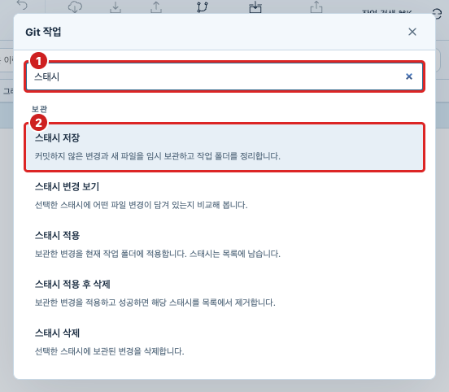

상단 작업 검색 버튼 또는 `⌘/Ctrl + K`로 엽니다. ①에 작업 이름이나 설명에 포함된 단어를 입력합니다. ② 각 작업 아래의 설명에서 파일·이력·원격 저장소에 어떤 변화가 생기는지 확인하고 선택합니다. 목록을 고르는 것만으로 Git 작업이 실행되지는 않습니다.

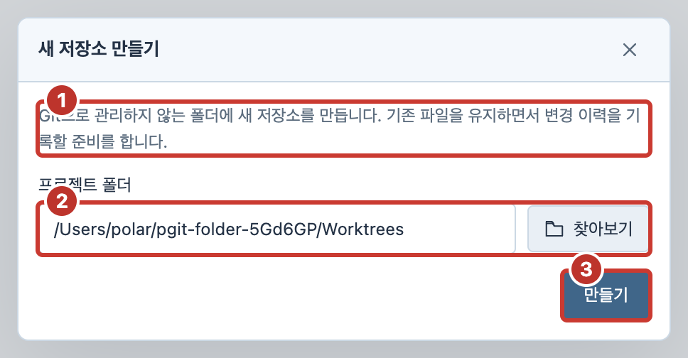

선택한 작업 화면에서도 ① 설명을 확인할 수 있습니다. 예를 들어 `새 저장소 만들기`는 ② `찾아보기`로 폴더 선택 창을 열고 대상 폴더를 선택합니다. 폴더 선택 창에서 `새로운 폴더`를 만들어 선택할 수도 있습니다. 선택한 경로를 확인한 뒤 ③ `만들기`를 누릅니다. 기존 파일을 유지하고 Git으로 변경 이력을 기록할 준비를 합니다. 파일이나 커밋을 과거 상태로 되돌리는 Reset과는 다릅니다. 대상과 옵션을 확인한 뒤 ③ 작업 버튼을 누릅니다.

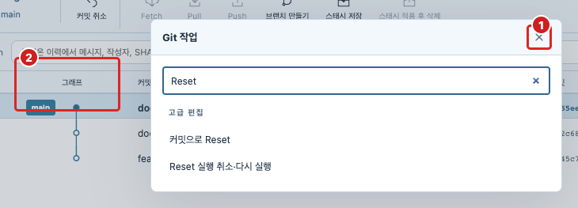

작업 검색 목록은 ① `×`, `Esc` 또는 ② 창 바깥을 눌러 닫습니다. 검색어 입력이나 목록 내부 클릭은 창을 닫지 않습니다.

## 커밋 목록에서 선택하기

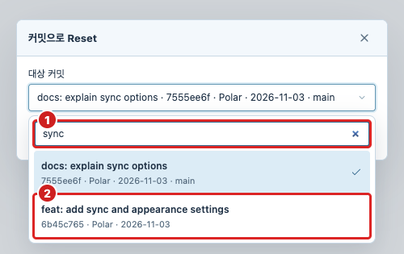

Reset·되돌림 커밋·두 커밋 비교·인터랙티브 리베이스·태그/워크트리 생성에서는 커밋 목록을 검색해 선택합니다. 브랜치 생성은 브랜치·커밋·직접 입력 중 시작점 방식을 고를 수 있고, 체리픽은 가져올 브랜치부터 선택합니다.

1. 커밋 선택란을 누르면 불러온 커밋이 최신 날짜순으로 표시됩니다. 메시지 아래에서 짧은 해시·작성자·날짜와 연결된 브랜치/태그를 확인합니다.
2. ①에 메시지, 작성자, 해시 또는 브랜치 이름을 입력해 목록을 좁힙니다. 검색 범위는 현재 불러온 커밋 목록입니다.
3. ②를 누르거나 방향키와 `Enter`로 선택합니다. `Esc`는 목록만 닫습니다.
4. 선택한 메시지를 확인하고 작업 버튼을 누릅니다. Reset은 먼저 변경 내용을 확인하는 화면으로 이동합니다.

커밋이나 브랜치의 메뉴에서 작업을 열면 해당 커밋이 미리 선택됩니다. 커밋 해시를 외울 필요가 없습니다.

## 기존 프로젝트 열기

1. 상단 `+`를 누르고 `로컬 열기`를 선택합니다.
2. 기존 Git 저장소의 폴더를 입력하거나 `찾아보기`로 선택합니다.
3. `프로젝트 열기`를 누릅니다. 새 탭의 프로젝트 이름과 현재 브랜치를 확인합니다.

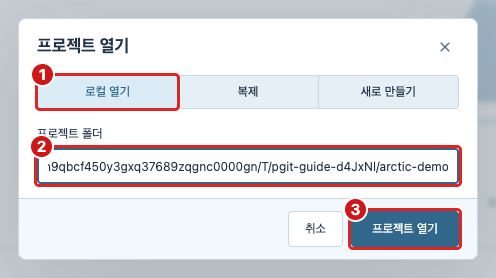

GitHub나 GitLab 계정 없이도 로컬 이력과 변경을 확인할 수 있습니다. Git 저장소가 아닌 새 폴더라면 아래 `새로 만들기`를 사용합니다.

## 새 프로젝트 만들기

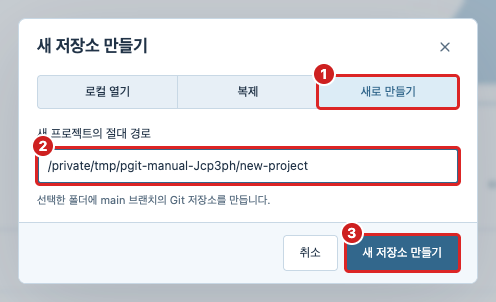

1. 상단 `+` → ① `새로 만들기`를 선택합니다.
2. ②에 프로젝트를 보관할 폴더의 절대 경로를 입력합니다. 이미 사용하는 프로젝트 폴더와 구분하세요.
3. ③ 만들기 버튼을 누릅니다.

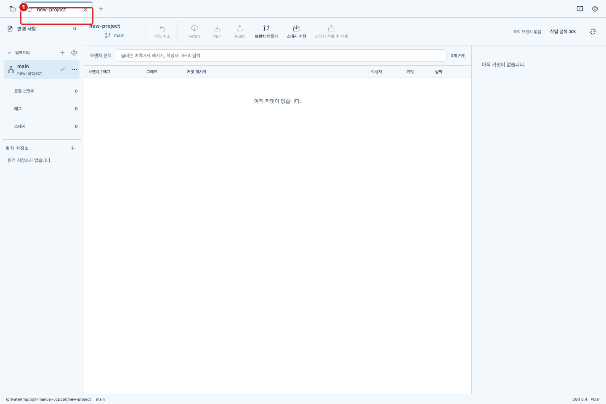

① 새 프로젝트 탭이 열리면 Git 저장소 생성이 완료된 것입니다. 아직 커밋이 없으므로 이력은 비어 있습니다. 폴더에 파일을 만든 뒤 `변경 사항`에서 스테이징하고 첫 커밋을 만듭니다. 원격 서버에 올리려면 원격을 추가하고 Push합니다.

## GitHub·GitLab 저장소 복제하기

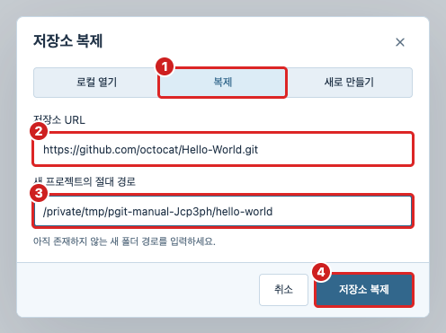

1. 원격 사이트의 저장소 페이지에서 HTTPS 또는 SSH 복제 주소를 복사합니다. 웹 브라우저의 파일·브랜치 페이지 주소가 아닌 저장소 복제 주소를 사용합니다.
2. 상단 `+` → ① `복제`를 선택합니다.
3. ②에 복사한 주소를 붙여 넣습니다. GitHub뿐 아니라 GitLab·사내 GitLab 주소도 사용할 수 있습니다.
4. ③에 복제할 새 폴더 경로를 입력합니다. 기존 파일이 있는 폴더는 피합니다.
5. ④ 복제 버튼을 누르고 완료될 때까지 기다립니다.

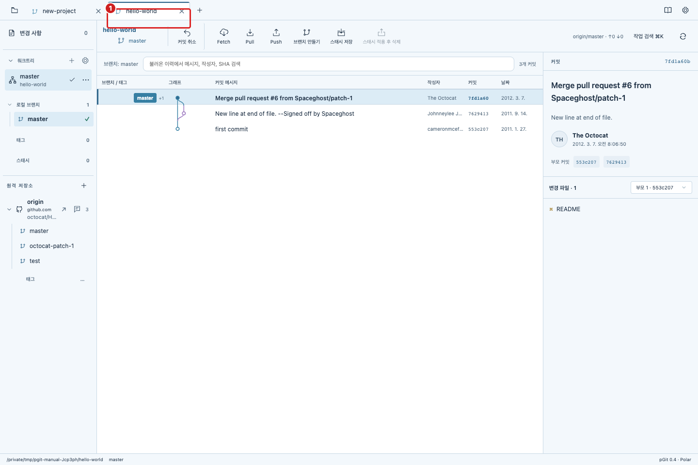

①에 새 탭이 열리고 커밋 이력이 나타나면 복제가 완료되었습니다. 왼쪽 원격 저장소의 `origin`과 현재 브랜치를 확인한 뒤 작업합니다. 비공개 저장소에서 인증이 실패하면 Git의 자격 증명 또는 SSH 키와 접근 권한을 확인합니다. 리뷰용 `gh`·`glab` 로그인과 Git 복제 인증은 별개입니다.

## 여러 프로젝트 탭 관리

탭을 클릭하면 프로젝트를 전환합니다. 탭을 드래그하면 순서를 바꿀 수 있습니다. `+`로 더 추가하고 각 탭의 `×`로 닫습니다. 폴더 아이콘은 프로젝트 홈으로 이동합니다. 탭을 닫아도 Git 파일은 삭제되지 않지만 작성 중인 커밋 메시지 초안은 사라질 수 있으므로 닫기 확인 내용을 읽으세요.

## 화면 구성과 브랜치 탐색

- 상단 탭: 여러 프로젝트를 전환합니다. 폴더 아이콘은 프로젝트 홈입니다.
- 왼쪽: 변경 사항, 워크트리, 로컬 브랜치, 태그, 스태시, 원격 저장소를 탐색합니다.
- 가운데: 선택한 브랜치의 이력 또는 파일 Diff를 표시합니다.
- 오른쪽: 선택한 커밋의 정보와 변경 파일, 또는 스테이징과 커밋 입력 영역을 표시합니다.

왼쪽 브랜치를 한 번 클릭하면 그 브랜치의 이력을 봅니다. 이 동작은 체크아웃이 아닙니다. 실제 작업 브랜치를 바꾸려면 상단의 현재 브랜치 버튼에서 전환합니다. 전환 전에 작업 중인 변경을 커밋하거나 스태시로 보관하세요.

## 브랜치 전환 — 열기부터 완료까지

왼쪽 브랜치 클릭은 이력 탐색입니다. 실제 파일을 다른 브랜치 상태로 바꾸는 전환은 아래 절차를 사용합니다. pGit은 작업 폴더에 변경이 있으면 전환을 거부하므로, 먼저 커밋하거나 `스태시 저장`으로 보관합니다.

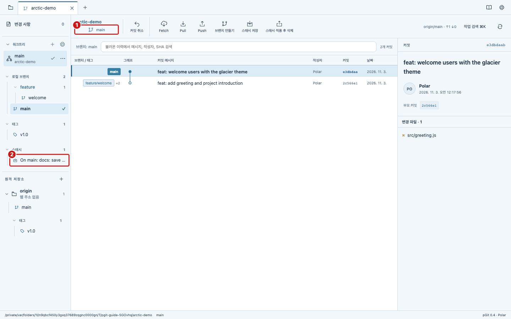

1. 사진의 ②는 README 수정 내용을 스태시에 보관한 상태입니다. 변경 사항이 없는지 확인합니다.
2. ① 상단 현재 브랜치 버튼을 누릅니다. 브랜치 전환 창이 열립니다.

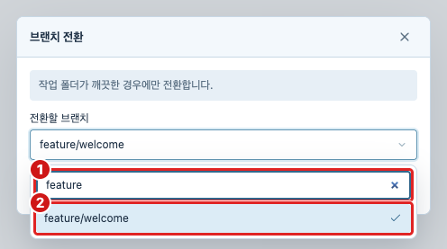

1. `전환할 브랜치` 선택 상자를 클릭합니다.
2. ① 검색에 브랜치 이름의 일부를 입력합니다. 예제에서는 `feature`입니다.
3. ② `feature/welcome`을 클릭합니다. 이 단계는 대상 선택이며 아직 파일이 바뀌지 않습니다.

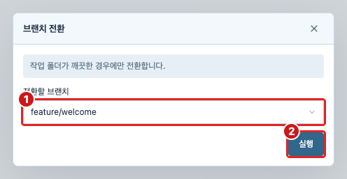

1. ①에 원하는 브랜치가 선택되었는지 확인합니다.
2. ② `브랜치 전환`을 누릅니다.

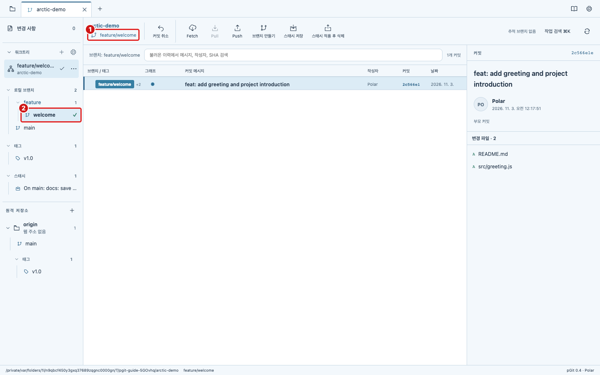

창이 닫히고 상단 ①이 `feature/welcome`으로 바뀌면 전환 완료입니다. 왼쪽 ②의 체크 표시도 이동합니다. 보관한 변경을 되살리려면 원하는 브랜치로 이동한 다음 스태시를 적용합니다.

## 브랜치 만들기

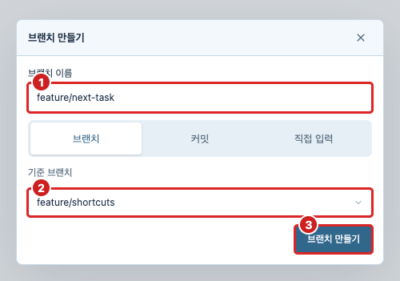

1. 상단 `브랜치 만들기` 또는 작업 검색의 `브랜치 만들기`를 누릅니다.
2. ① 이름을 입력합니다. `feature/draft`처럼 `/`를 사용하면 왼쪽 목록에서 폴더로 묶입니다.
3. ② 목록에서 기준 브랜치를 검색해 선택합니다. 기본값은 현재 브랜치입니다. 원격 브랜치를 고르면 마지막 Fetch로 가져온 상태를 기준으로 만듭니다.
4. ③ `브랜치 만들기`를 누릅니다.

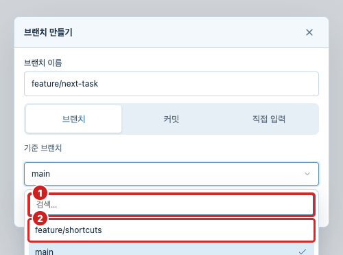

로컬·원격 브랜치를 이름으로 검색할 수 있습니다. 예를 들어 `origin/main`에서 새 작업을 시작하려면 해당 원격 브랜치를 선택합니다.

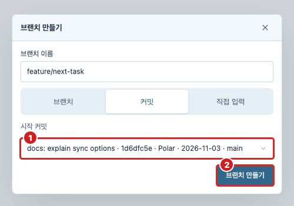

특정 시점에서 시작하려면 `커밋`을 누르고 메시지·작성자·해시로 검색합니다.

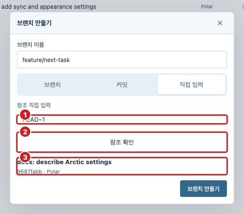

`직접 입력`에서는 `HEAD`, `HEAD~2`, 브랜치 이름, 태그, 커밋 해시를 사용할 수 있습니다. `HEAD~2`는 현재 커밋에서 첫 번째 부모를 두 번 따라간 커밋입니다. ②로 실제 커밋 메시지와 해시를 확인한 뒤 실행합니다. 잘못된 참조로는 브랜치를 만들지 않습니다.

①에 새 브랜치가 나타납니다. 생성만으로 작업 브랜치가 바뀌지는 않습니다. 해당 브랜치에서 작업하려면 `브랜치 전환`을 이어서 진행합니다.

## 브랜치 이름 변경

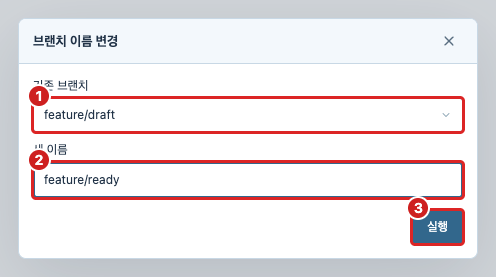

1. `⌘/Ctrl + K` → `브랜치 이름 변경`을 선택합니다.
2. ①에서 바꿀 로컬 브랜치를 선택합니다.
3. ②에 새 이름을 입력하고 ③ 실행을 누릅니다.

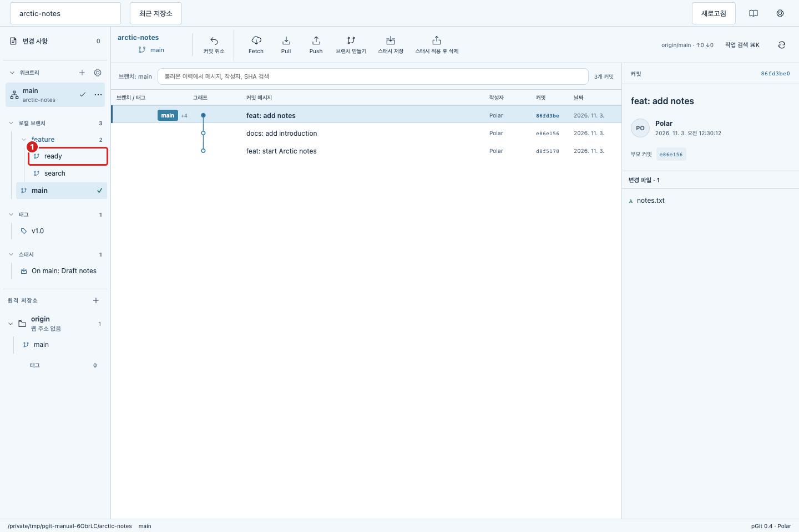

①에서 변경한 이름을 확인합니다. 로컬 브랜치의 이름을 바꾸는 기능이며 서버의 기존 브랜치 이름까지 자동으로 바꾸지는 않습니다.

## 브랜치 삭제

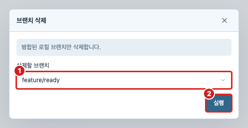

1. 삭제할 브랜치에서 작업 중이라면 다른 브랜치로 먼저 전환합니다.
2. `⌘/Ctrl + K` → `브랜치 삭제`를 선택합니다.
3. ① 목록에서 삭제할 브랜치를 선택합니다. 이름이 비슷한 브랜치를 혼동하지 않도록 전체 이름을 확인합니다.
4. ② 실행을 누릅니다. 병합되지 않은 커밋이 있거나 사용 중인 브랜치이면 삭제가 거부될 수 있습니다.

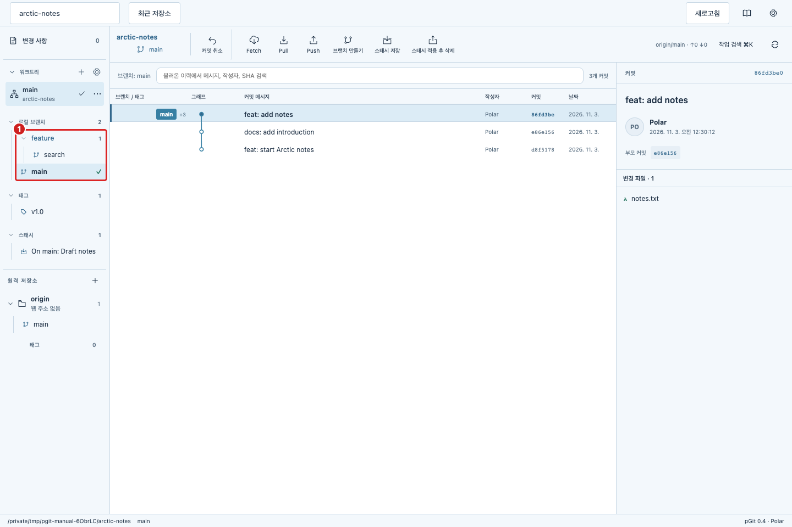

①에서 삭제한 이름이 사라졌는지 확인합니다. 서버 브랜치를 삭제하는 작업은 아닙니다.

## 변경 검토와 커밋

1. `변경 사항`을 열고 작업 중인 파일을 선택합니다.
2. Diff에서 수정 내용을 확인합니다.
3. 커밋에 넣을 파일을 스테이징합니다. 모든 파일을 넣을 때는 `전체 스테이징`, 다시 검토할 때는 `전체 해제`를 사용합니다.
4. 커밋 메시지를 입력합니다. 필요한 경우 상세 설명도 작성합니다.
5. 스테이징한 변경을 커밋합니다. 스테이징하지 않은 변경은 작업 폴더에 남습니다.

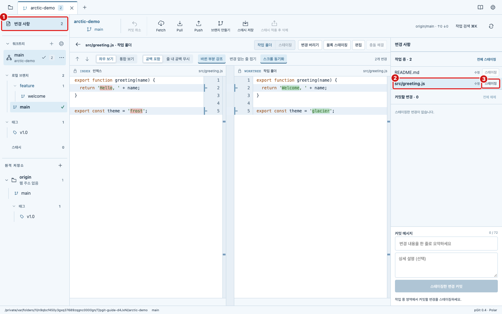

1. 빨간 ① `변경 사항`을 클릭합니다.
2. 빨간 ② `src/greeting.js`를 클릭해 가운데 Diff를 읽습니다.
3. 이 파일의 변경을 모두 다음 커밋에 넣으려면 빨간 ③ `스테이징`을 클릭합니다. 일부만 넣으려면 상단의 `블록 스테이징`을 사용하세요.

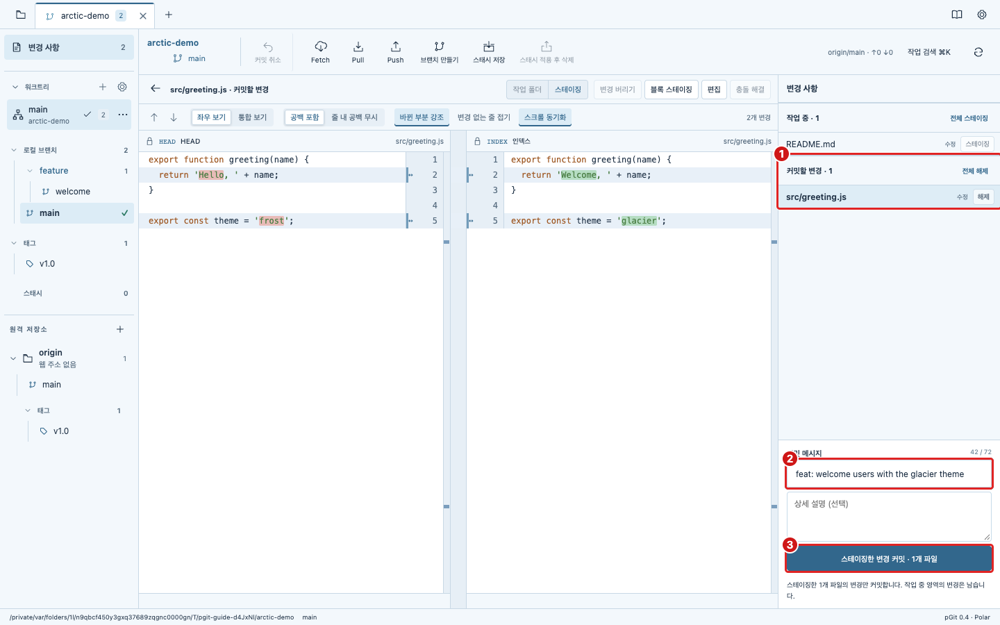

1. 빨간 ①에 커밋할 파일이 들어왔는지 확인합니다. 예제에서 `README.md`는 작업 중 영역에 남겨 둡니다.
2. 빨간 ②에 이번 커밋의 목적을 적습니다.
3. 빨간 ③을 누릅니다. 스테이징한 `src/greeting.js`만 커밋되고 `README.md` 수정은 작업 폴더에 남습니다.

스테이징은 다음 커밋에 넣을 변경을 고르는 단계입니다. 커밋은 로컬 저장소에 기록하며, 원격 서버에 보내는 Push는 별도 작업입니다.

한 파일에서 일부만 커밋하려면 `블록 스테이징`으로 변경 블록 또는 줄을 선택합니다. 먼저 선택한 부분을 스테이징하고 커밋한 뒤 나머지를 다음 커밋으로 나눌 수 있습니다. `편집`은 실제 작업 폴더의 파일 내용을 수정하는 기능입니다.

## 작업 검색으로 기능 찾기

현재 프로젝트에서 `⌘/Ctrl + K`를 누르고 기능 이름을 검색합니다. 항목을 누르면 입력 창이나 결과 화면이 열립니다. 입력 창의 `실행`은 해당 작업을 수행하며, 미리보기가 필요한 작업은 검토 화면으로 이동합니다. 다음 절차에서 “작업 검색”은 이 경로를 뜻합니다.

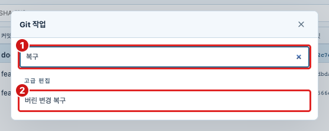

1. ①에 `복구`를 입력합니다.
2. ② `버린 변경 복구`를 선택하고 다음 창에서 실행해 복구 목록을 엽니다.
3. 원하는 항목이 없으면 검색어를 지웁니다. 저장소·브랜치·동기화·커밋·보관·고급 편집·GitHub·GitLab 등의 기능 목록을 볼 수 있습니다.

## 한 파일의 일부만 커밋하기

파일 전체를 스테이징하는 것과, 선택한 줄만 스테이징하는 것은 다릅니다. 서로 관련 없는 변경을 별도 커밋으로 나눌 때 사용합니다.

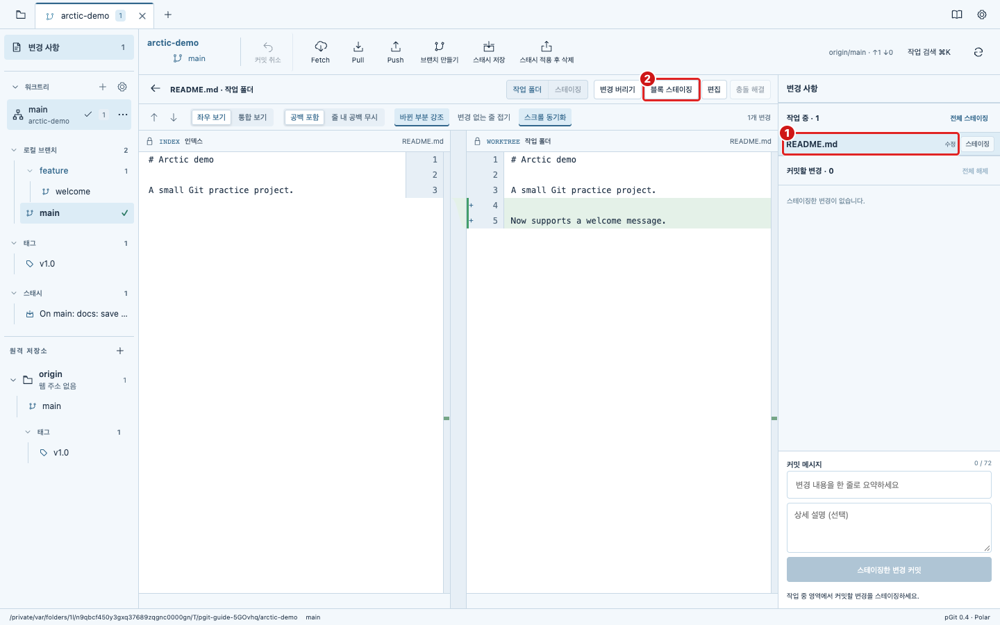

1. 변경 사항에서 ① 파일을 선택합니다.
2. ② `블록 스테이징`을 누릅니다. 변경 블록과 추가·삭제 줄의 체크박스가 나타납니다.

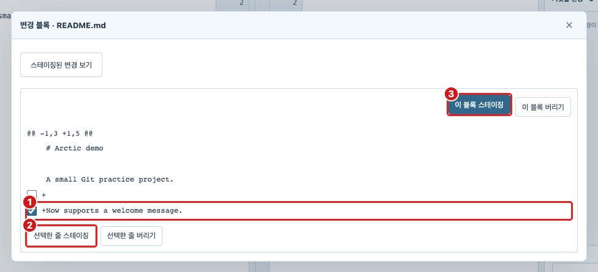

1. ①에서 넣을 줄만 체크합니다. 기존 문장을 교체하는 변경이면 삭제 줄과 추가 줄을 함께 검토합니다.
2. ② `선택한 줄 스테이징`을 클릭합니다. 블록 전체를 넣으려는 경우에만 ③을 사용합니다.
3. 창을 닫고 커밋할 변경과 작업 중 영역을 확인합니다.

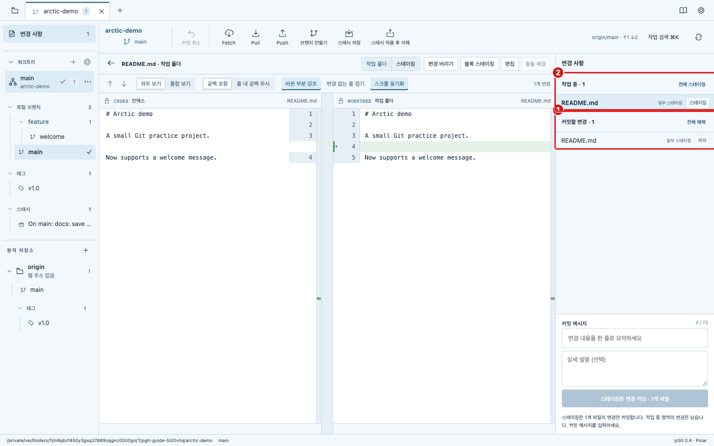

같은 파일이 양쪽에 나타나도 정상입니다. ①에는 선택한 내용, ②에는 나머지 내용이 있습니다. 이 예제는 문장 추가만 스테이징하고 빈 줄 추가는 작업 폴더에 남겼습니다. ①의 Diff를 확인하고 메시지를 작성해 커밋하면 선택한 내용만 기록됩니다.

잘못 골랐다면 블록 창에서 `스테이징된 변경 보기`로 바꿔 블록 또는 선택 줄을 해제합니다. 해제는 파일 내용을 지우지 않습니다. `이 블록 버리기`와 `선택한 줄 버리기`는 작업 변경을 실제로 제거하므로 스테이징 해제와 구분하세요.

## 파일 편집·무시·변경 버리기와 복구

- 편집: 변경 파일 선택 → `편집` → 코드 수정 → `파일 저장`. 저장 후 Diff를 다시 검토하고 별도로 스테이징·커밋합니다.
- 무시: 작업 검색 → `파일 무시` → 추적하지 않는 파일 경로 → 실행. 이미 Git이 추적하는 파일을 이력에서 제거하는 기능은 아닙니다. 생성된 `.gitignore` 변경도 검토합니다.
- 파일 변경 버리기: 파일 선택 → `변경 버리기` → 변경 전후 검토 → `파일 변경 버리기`. 스테이징하지 않은 내용에 적용됩니다.
- 일부만 버리기: `블록 스테이징` 창에서 블록 또는 변경 줄을 고른 뒤 해당 버리기 버튼을 사용합니다.
- 복구: 작업 검색 → `버린 변경 복구` → 실행 → 목록에서 파일·시간 확인 → `복구`. 복구한 항목에는 `다시 버리기`가 표시됩니다.

복구는 pGit이 저장한 기록을 대상으로 합니다. 복구 후 파일이 달라졌다면 덮어쓰기를 막기 위해 거부될 수 있습니다. 외부 편집기나 다른 Git 도구에서 삭제한 내용까지 자동 복원하는 기능은 아닙니다.

### 파일 편집 — 입력과 실행

작업 검색(`⌘/Ctrl + K`)에서 `파일 편집`을 선택합니다.

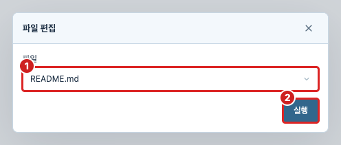

1. `파일`: 대상 파일을 선택합니다.
2. `실행`을 누릅니다. 편집 화면에서 내용을 고치고 `파일 저장`을 누릅니다. 변경 사항의 Diff를 확인한 뒤 별도로 스테이징·커밋합니다.

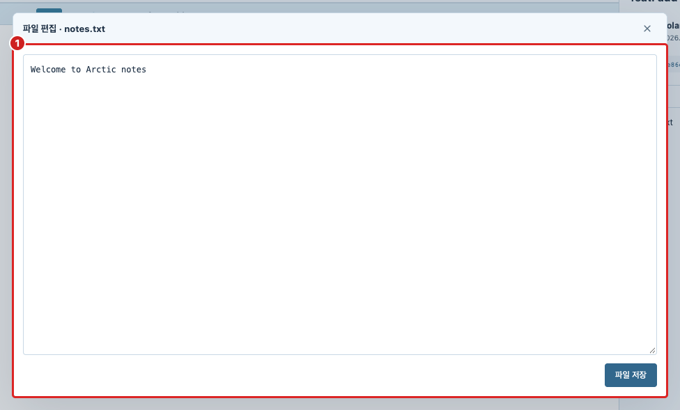

### 파일 무시 — 입력과 실행

작업 검색(`⌘/Ctrl + K`)에서 `파일 무시`를 선택합니다.

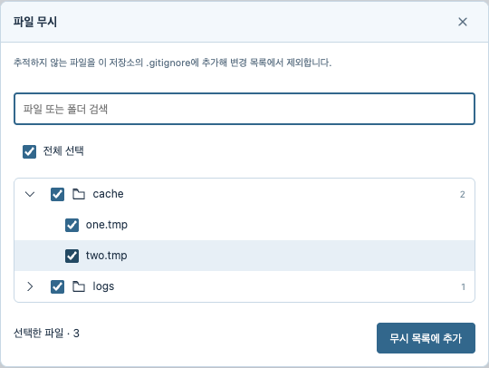

1. `추적하지 않는 파일 경로`: 저장소 기준 파일 경로를 입력합니다.
2. `실행`을 누릅니다. `.gitignore` 변경을 확인하고 커밋합니다. 이미 추적 중인 파일은 이 기능으로 숨길 수 없습니다.

### 파일 변경 버리기 — 입력과 실행

작업 검색(`⌘/Ctrl + K`)에서 `파일 변경 버리기`를 선택합니다.

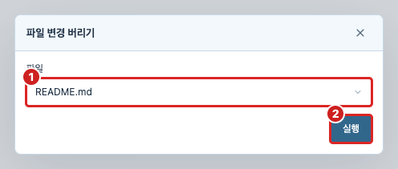

1. `파일`: 대상 파일을 선택합니다.
2. `실행`을 누릅니다. 다음 검토 화면에서 버릴 내용을 확인하고 `파일 변경 버리기`를 누릅니다. 실행 후 작업 중 목록과 파일 내용을 확인합니다.

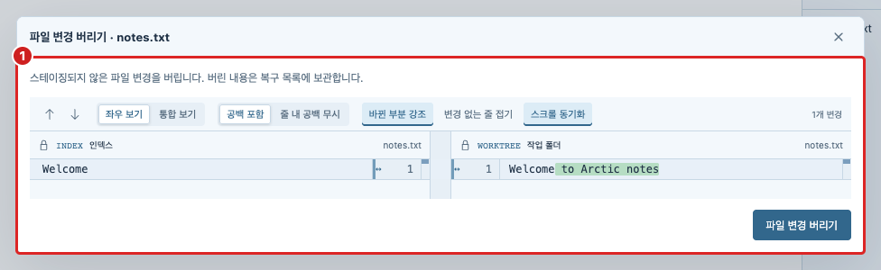

### 버린 변경 복구 — 입력과 실행

작업 검색(`⌘/Ctrl + K`)에서 `버린 변경 복구`를 선택합니다.

1. `실행`을 누릅니다. 파일명과 시간을 확인하고 `복구`를 누릅니다. 복구가 끝나면 `다시 버리기`로 바뀌고 해당 수정이 작업 폴더에 돌아옵니다.

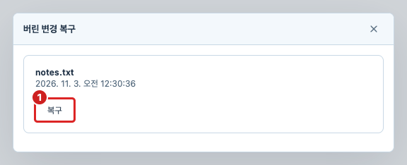

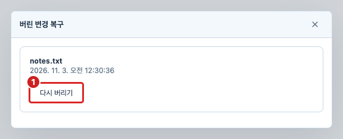

복구 후 버튼이 `다시 버리기`로 바뀝니다. 변경 사항으로 돌아가 복원된 내용을 확인합니다.

## Diff 읽기

- `좌우 보기`: 왼쪽은 변경 전, 오른쪽은 변경 후입니다. 줄 번호와 가운데 연결 영역으로 대응하는 변경을 확인합니다.
- `통합 보기`: 삭제된 줄과 추가된 줄을 하나의 화면에서 함께 봅니다.
- 위·아래 화살표: 이전 변경 또는 다음 변경 위치로 이동합니다.
- `공백 포함`: 공백과 탭의 차이도 변경으로 표시합니다.
- `줄 내 공백 무시`: 줄 안의 공백·탭 차이를 비교 표시에서 무시합니다. 파일 자체는 변경하지 않습니다.
- `바뀐 부분 강조`: 수정된 줄 안에서 달라진 단어를 강조합니다.
- `변경 없는 줄 접기`: 긴 공통 구간을 접고 변경 주변을 남깁니다. 접힌 줄 수를 눌러 펼칠 수 있습니다.
- `스크롤 동기화`: 좌우 비교 화면을 함께 스크롤합니다.

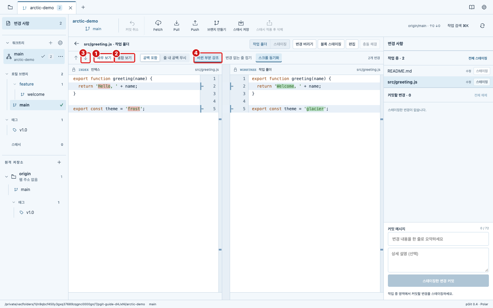

1. 빨간 ①은 변경 전후를 나란히 보여 줍니다.
2. 빨간 ②로 바꾸면 삭제·추가 줄을 한 화면에서 봅니다.
3. 빨간 ③으로 다음 변경 위치에 이동합니다. 왼쪽 위 화살표는 이전 변경입니다.
4. 빨간 ④를 켜고 끄며 줄 안에서 달라진 단어를 확인합니다.

커밋 이력에서 파일을 선택하면 해당 커밋의 변경 전후를 비교합니다. `크게 보기`로 비교 영역을 넓힐 수 있습니다. 코드 글꼴과 줄 간격은 설정에서 별도로 조절합니다.

## 이력 검색과 커밋 상세

1. 왼쪽에서 확인할 브랜치를 선택합니다.
2. 이력 위 검색창에 커밋 메시지, 작성자 또는 SHA를 입력합니다. 검색은 현재 불러온 이력 범위에서 수행됩니다.
3. 커밋 행을 선택하면 오른쪽에 메시지, 작성자, 날짜, 부모 커밋과 변경 파일이 나타납니다.
4. 변경 파일을 선택해 Diff를 확인합니다. 부모 커밋 해시를 누르면 해당 커밋으로 이동합니다.

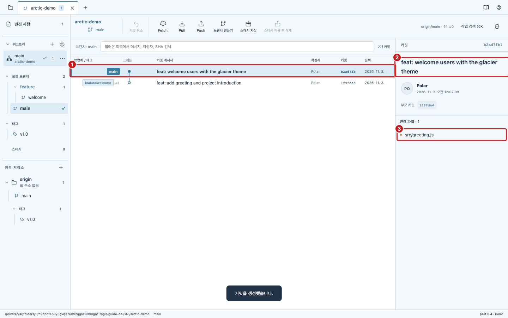

1. 빨간 ①은 앞 단계에서 만든 커밋입니다. 선택하면 오른쪽 상세 정보가 바뀝니다.
2. 빨간 ②에서 메시지를 확인합니다.
3. 빨간 ③의 변경 파일을 클릭하면 해당 커밋의 Diff로 이동합니다. 예제에서는 커밋한 파일만 나타납니다.

더 넓은 범위의 메시지를 찾을 때는 작업 검색의 `전체 이력 메시지 검색`을 사용할 수 있습니다. 커밋 선택과 이력 탐색만으로 작업 폴더의 파일이 바뀌지는 않습니다.

### 전체 이력 메시지 검색 — 입력과 실행

작업 검색(`⌘/Ctrl + K`)에서 `전체 이력 메시지 검색`을 선택합니다.

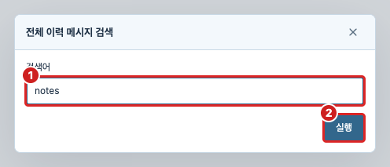

1. `검색어`: 찾을 커밋 메시지의 일부를 입력합니다.
2. `실행`을 누릅니다. 불러온 그래프 범위보다 넓게 커밋 메시지를 검색합니다. 결과의 해시와 제목을 확인합니다.

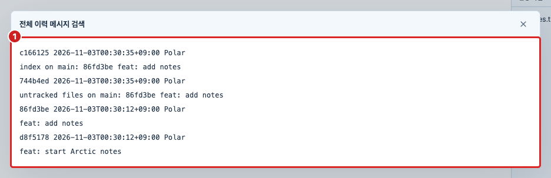

## 원격 저장소와 동기화

원격 저장소 제목 옆 `+`에서 원격 이름과 URL을 추가합니다. `origin`, `upstream` 등 여러 원격을 각각 관리할 수 있습니다. 원격 아래 브랜치는 Fetch로 가져온 원격 추적 참조입니다.

- `Fetch`: 원격의 커밋과 브랜치 정보를 가져옵니다. 현재 브랜치에 병합하지 않습니다.
- `Pull`: 추적 브랜치의 변경을 현재 브랜치에 반영합니다. 선택한 방식에 따라 fast-forward, 병합 또는 rebase를 사용합니다.
- `Push`: 현재 브랜치의 커밋을 선택한 원격으로 보냅니다.

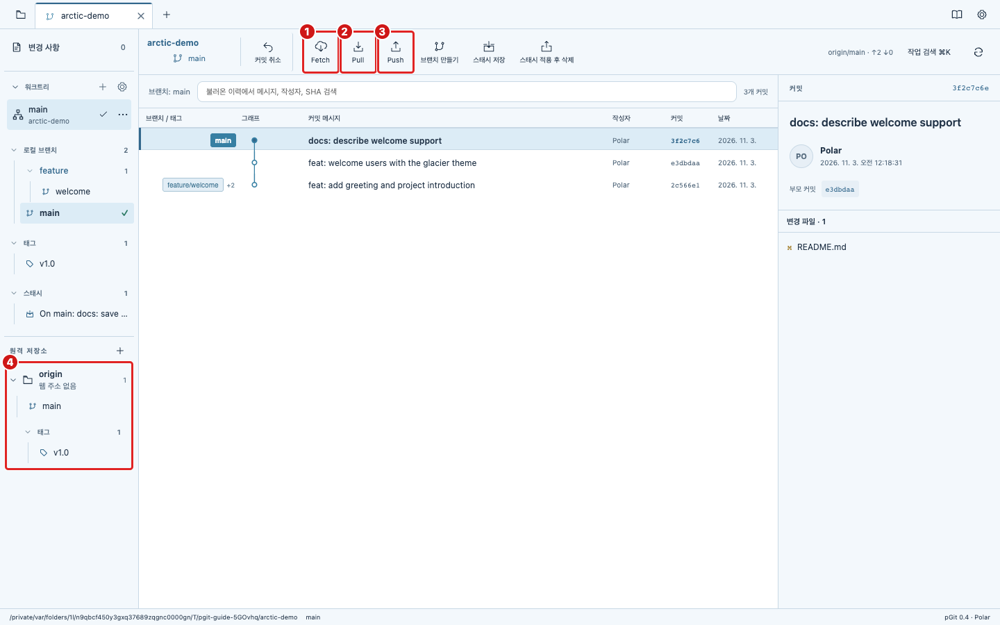

1. 원격 정보를 가져오기만 하려면 빨간 ① Fetch를 사용합니다.
2. 현재 브랜치에도 반영하려면 빨간 ② Pull입니다.
3. 로컬 커밋을 서버에 보내려면 빨간 ③ Push입니다.
4. 빨간 ④는 이 프로젝트의 `origin` 브랜치·태그 목록입니다. GitHub/GitLab URL을 등록한 원격은 웹 링크와 리뷰 버튼도 표시됩니다.

Fetch는 버튼 클릭 후 원격 선택 창에서 대상을 고르고 실행합니다. Pull은 방식 선택 후 실행합니다. `Fast-forward only`는 로컬과 원격이 갈라졌으면 중단하고, `Merge`는 병합, `Rebase`는 로컬 커밋을 원격 이력 위에 다시 적용합니다. Pull하려면 현재 브랜치의 추적 브랜치가 필요합니다.

Push는 원격 선택 → 실행 → 상단 앞섬/뒤처짐 수와 원격 이력 확인 순서입니다. 현재 브랜치를 원격의 같은 이름 브랜치로 보내며 강제 Push는 하지 않습니다. 거부되면 Fetch로 원격 상태를 확인하고 병합이나 리베이스가 필요한지 판단합니다.

원격 URL 확인은 작업 검색의 `원격 주소 보기`, 제거는 `원격 제거`를 사용합니다. 제거는 로컬의 원격 설정과 원격 추적 참조를 지우며 서버 저장소 자체를 삭제하지 않습니다.

원격 이름의 링크는 해당 저장소 웹사이트를 엽니다. 옆 리뷰 아이콘은 PR/MR, 이슈, CI 작업의 진입점입니다. 원격 URL이 등록되어 있다는 것과 리뷰 API에 로그인되어 있다는 것은 별개입니다.

설정의 `동기화`에서 자동 Fetch를 끄거나 5·10·30분으로 설정합니다. 기본은 10분입니다. 활성 프로젝트에서 실행하며 Git 작업, 설정 또는 모달 사용 중에는 미룹니다. 자동 Fetch는 Pull이나 병합을 실행하지 않습니다.

### 원격 추가 — 입력과 실행

작업 검색(`⌘/Ctrl + K`)에서 `원격 추가`를 선택합니다.

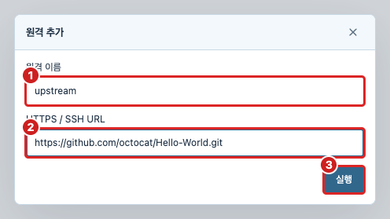

1. `원격 이름`: 추가할 때는 origin·upstream처럼 구분할 이름을 입력하고, 제거할 때는 기존 원격을 선택합니다.
2. `HTTPS / SSH URL`: 저장소의 HTTPS 또는 SSH 복제 주소를 입력합니다.
3. `실행`을 누릅니다. 목록에 원격 이름이 추가됩니다. Fetch로 원격 브랜치를 가져온 뒤 원격 아래 목록을 펼쳐 확인합니다.

### 원격 주소 보기 — 입력과 실행

작업 검색(`⌘/Ctrl + K`)에서 `원격 주소 보기`를 선택합니다.

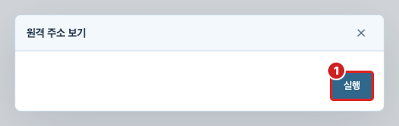

1. `실행`을 누릅니다. 원격 이름과 Fetch/Push 주소가 출력됩니다. 다른 프로젝트의 주소가 들어 있지 않은지 확인합니다.

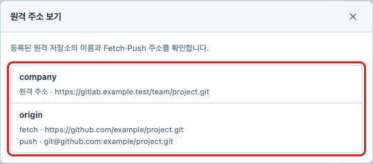

### 원격 제거 — 입력과 실행

작업 검색(`⌘/Ctrl + K`)에서 `원격 제거`를 선택합니다.

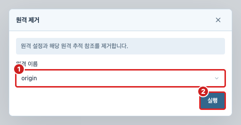

1. `원격 이름`: 추가할 때는 origin·upstream처럼 구분할 이름을 입력하고, 제거할 때는 기존 원격을 선택합니다.
2. `실행`을 누릅니다. 선택한 원격이 왼쪽 목록에서 사라집니다. 서버 저장소나 로컬 작업 파일은 삭제되지 않습니다.

### Fetch — 입력과 실행

작업 검색(`⌘/Ctrl + K`)에서 `Fetch`를 선택합니다.

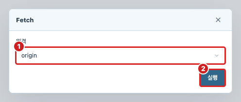

1. `원격`: 원하는 원격 저장소를 선택합니다. origin과 upstream이 함께 있으면 서버 주소도 확인합니다.
2. `실행`을 누릅니다. 왼쪽 원격 브랜치와 상단 앞섬·뒤처짐 수를 확인합니다. 작업 브랜치에는 자동 병합하지 않습니다.

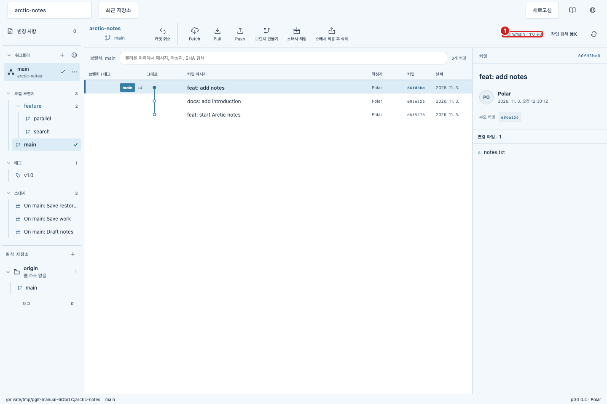

### Pull — 입력과 실행

작업 검색(`⌘/Ctrl + K`)에서 `Pull`를 선택합니다.

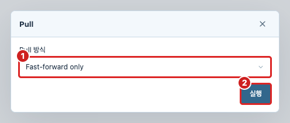

1. `Pull 방식`: Fast-forward only, Merge, Rebase 중 사용할 방식을 선택합니다.
2. `실행`을 누릅니다. 현재 브랜치의 이력에 원격 변경이 반영됩니다. 충돌이 발생하면 충돌 해결 절차를 진행합니다.

### Push — 입력과 실행

작업 검색(`⌘/Ctrl + K`)에서 `Push`를 선택합니다.

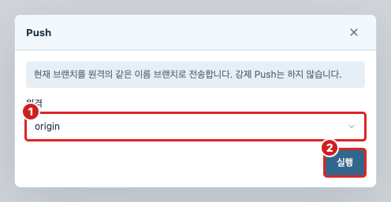

1. `원격`: 원하는 원격 저장소를 선택합니다. origin과 upstream이 함께 있으면 서버 주소도 확인합니다.
2. `실행`을 누릅니다. 원격 추적 브랜치와 현재 브랜치의 차이를 확인합니다. 처음 Push하면 추적 브랜치도 설정됩니다.

## 로컬 태그와 원격 태그

독립된 `태그` 목록은 로컬에 있는 태그입니다. 원격에서 가져온 태그도 여기에 포함됩니다. 태그는 특정 브랜치가 아니라 커밋 등의 Git 객체를 가리킵니다. 작업 검색에서 태그를 만들거나 로컬 태그를 삭제할 수 있습니다.

각 원격 아래 `태그`는 서버에 실제로 있는 태그를 별도로 조회한 목록입니다. 프로젝트 진입 시와 자동 Fetch 주기에 갱신하며, 로컬 목록과 같다고 가정하지 않습니다. 서버 조회만으로 로컬 태그를 생성하거나 덮어쓰지 않습니다. 원격 태그 목록은 현재 읽기 전용이며 이름 위에 마우스를 올리면 해시를 볼 수 있습니다. 조회 중은 `…`, 조회 실패는 이전 목록을 유지하거나 `!`로 표시합니다.

태그 만들기: 작업 검색 → `태그 만들기` → 이름·대상 커밋·설명 입력 → 실행. 설명이 비어 있으면 lightweight 태그입니다. 로컬 태그 목록에서 결과를 확인합니다. 삭제는 `로컬 태그 삭제`에서 이름을 선택합니다. 로컬 생성·삭제가 곧 원격 태그 변경을 뜻하지는 않습니다. 현재 일반 Push는 브랜치 전송이며, 별도의 원격 태그 게시·삭제 UI는 제공하지 않습니다.

### 태그 만들기 — 입력과 실행

작업 검색(`⌘/Ctrl + K`)에서 `태그 만들기`를 선택합니다.

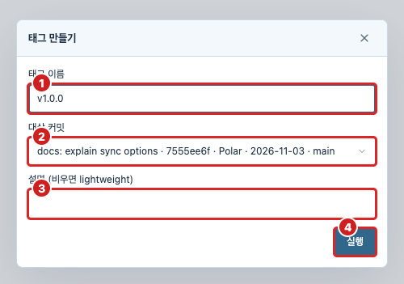

1. `태그 이름`: 새 태그 이름을 입력합니다.
2. `대상 커밋`: 태그를 붙일 커밋을 메시지·작성자·해시로 검색해 선택합니다.
3. `설명 (비우면 lightweight)`: 설명을 넣으면 annotated 태그, 비우면 lightweight 태그로 만듭니다.
4. `실행`을 누릅니다. 왼쪽 로컬 태그 목록에 새 이름이 나타납니다. 서버 게시까지 수행하지는 않습니다.

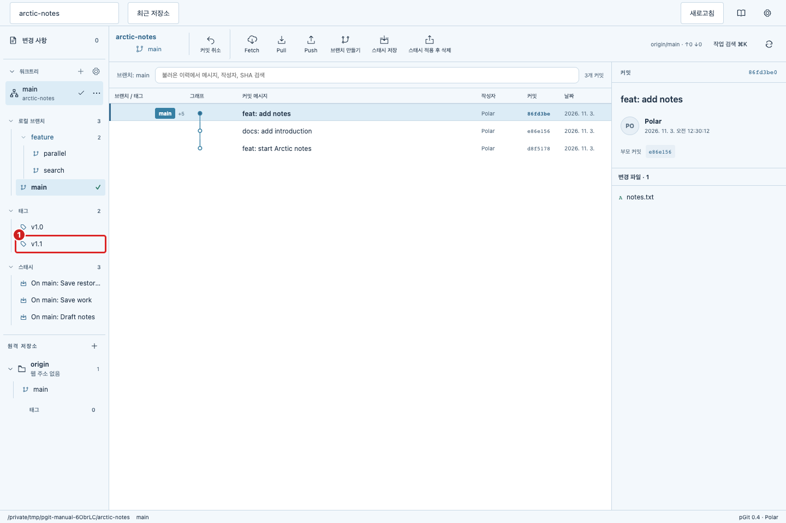

### 로컬 태그 삭제 — 입력과 실행

작업 검색(`⌘/Ctrl + K`)에서 `로컬 태그 삭제`를 선택합니다.

1. `태그`: 삭제할 로컬 태그를 선택합니다.
2. `실행`을 누릅니다. 해당 이름이 로컬 태그 목록에서 사라집니다. 원격 서버 태그는 별도로 남습니다.

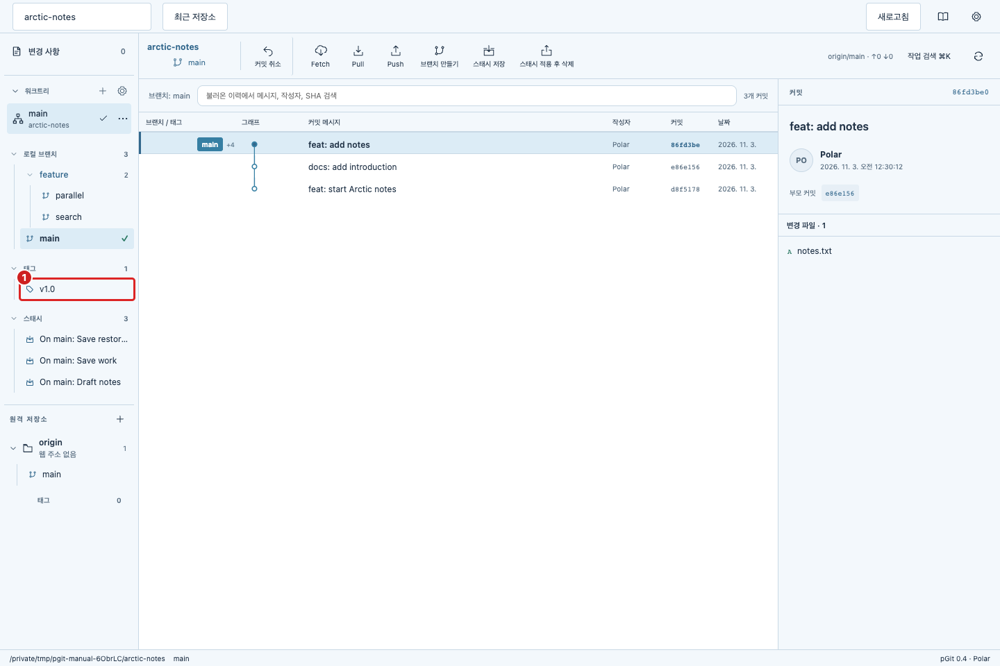

## 스태시 저장·확인·적용·삭제

스태시는 커밋하지 않은 작업을 로컬에 잠시 보관합니다. pGit의 스태시 저장은 추적하지 않는 새 파일도 포함합니다. 공유하려면 커밋과 Push를 사용합니다.

1. 상단 `스태시 저장`을 누릅니다.
2. ① 설명을 입력합니다. 예제에서는 브랜치 전환 전에 README 작업을 보관했습니다.
3. ② 실행 후 변경 사항이 정리되고 왼쪽 스태시 목록이 늘어나는지 확인합니다.
4. 왼쪽 스태시 항목을 누르면 보관된 Diff를 확인할 수 있습니다.

1. 복원할 브랜치로 먼저 전환합니다.
2. 작업 검색의 `스태시 적용`을 엽니다. ①에서 이름·설명을 확인해 대상을 고릅니다.
3. ② 실행 후 변경 사항 화면에서 복원된 파일을 확인합니다. 적용한 변경은 작업 폴더에 복원되고 스태시는 목록에 남습니다.

- `스태시 적용`: 변경을 복원하고 보관본은 남깁니다.
- `스태시 적용 후 삭제`: 복원이 성공하면 보관본을 지웁니다.
- `스태시 삭제`: 파일에 적용하지 않고 보관본만 지웁니다. 먼저 Diff를 확인하세요.

적용할 때 현재 파일과 충돌할 수 있습니다. 충돌이 나면 파일을 정리하고 결과를 확인하세요. 실패했다고 같은 스태시를 반복 적용하지 마세요.

### 스태시 변경 보기 — 입력과 실행

작업 검색(`⌘/Ctrl + K`)에서 `스태시 변경 보기`를 선택합니다.

1. `스태시`: 설명과 순서를 확인해 대상 보관본을 선택합니다.
2. `실행`을 누릅니다. 추가·삭제된 줄이 출력됩니다. 파일을 바꾸지 않고 보관 내용을 확인하는 단계입니다.

### 스태시 적용 후 삭제 — 입력과 실행

작업 검색(`⌘/Ctrl + K`)에서 `스태시 적용 후 삭제`를 선택합니다.

1. `스태시`: 설명과 순서를 확인해 대상 보관본을 선택합니다.
2. `실행`을 누릅니다. 변경 사항에서 복원된 파일을, 스태시 목록에서 보관본이 제거되었는지 확인합니다. 충돌이 나면 내용을 정리하기 전까지 다시 적용하지 마세요.

### 스태시 삭제 — 입력과 실행

작업 검색(`⌘/Ctrl + K`)에서 `스태시 삭제`를 선택합니다.

1. `스태시`: 설명과 순서를 확인해 대상 보관본을 선택합니다.
2. `실행`을 누릅니다. 선택한 스태시가 목록에서 사라집니다. 파일에 적용하지 않고 보관본을 삭제하므로 먼저 변경 내용을 확인하세요.

## 워크트리

워크트리는 같은 저장소의 다른 브랜치를 별도 폴더에서 작업하는 기능입니다. 원래 폴더의 작업을 유지한 채 다른 작업을 진행할 때 유용합니다.

1. 왼쪽 `워크트리` 옆 `+`를 누릅니다.
2. 시작 커밋과 새 브랜치 이름을 정하고 `위치 선택`으로 폴더를 고릅니다. 작업 검색의 `Worktree 만들기`에서도 같은 화면이 열립니다.
3. 만든 항목을 클릭하면 프로젝트 탭으로 엽니다.
4. 제목 옆 관리 아이콘은 전체 관리, 항목의 `⋯`는 해당 워크트리 관리입니다.

1. 빨간 ①에 새 브랜치 이름을 입력합니다.
2. 빨간 ②에서 시작 커밋을 검색해 선택합니다. 기본값은 현재 커밋입니다.
3. ③ `위치 선택`을 누르고 새 작업 폴더를 둘 위치를 고릅니다. 선택한 폴더 안에 프로젝트 이름과 새 브랜치 이름을 조합한 폴더를 만듭니다. 선택 창에서 취소하면 기존 경로와 입력 내용이 유지됩니다.
4. ④에서 최종 경로를 확인하고 ⑤ `만들기`를 누릅니다. 폴더를 선택하는 것만으로 워크트리가 생성되지는 않습니다. 브라우저 실행 환경에서는 작업 폴더 경로를 직접 입력할 수 있습니다.

생성 후 ① 목록에 `feature/next-task`가 나타납니다. 항목을 선택하고 상세의 `프로젝트 탭으로 열기`를 누르거나, 관리 창을 닫고 왼쪽 워크트리 항목을 클릭합니다. 별도 탭에서 브랜치와 폴더를 확인한 뒤 작업합니다.

워크트리 관리에서는 브랜치·폴더 검색, 새로고침, 잠금·잠금 해제와 제거가 가능합니다. 잠금은 실수로 폴더를 제거하지 않도록 보호할 때 사용합니다. 제거 전에 변경 수와 실제 경로를 확인하세요. 현재 프로젝트, 기본 작업 폴더, 수정 중이거나 잠긴 폴더 등은 제거가 제한됩니다. 워크트리 제거와 브랜치 삭제는 별개의 작업입니다.

### 열기·잠금·삭제

관리 창에서 항목을 선택하고 `프로젝트 탭으로 열기`를 누르면 해당 폴더에서 작업합니다. 폴더를 보호하려면 `잠금`을 누릅니다.

잠긴 항목은 삭제할 수 없습니다. 삭제가 필요하면 ① `잠금 해제`를 누릅니다.

`삭제`를 누르면 확인 영역이 열립니다. 경로와 변경 수를 확인한 뒤 ① `작업 폴더 삭제`를 누릅니다. 완료되면 목록에서 사라지며 브랜치·커밋은 유지됩니다.

## 파일 이력·Blame·두 참조 비교

1. 작업 검색의 `파일 이력`에서 추적 파일을 고르고 실행합니다. 해당 파일을 바꾼 커밋을 확인할 때 사용합니다.
2. `줄별 작성 이력`(Blame)에서 추적 파일을 고르면 줄별 마지막 변경 정보를 확인할 수 있습니다. 잘못을 판정하는 기능이 아니라 수정 맥락을 찾는 도구입니다.
3. `두 커밋 비교`에서 이전 참조와 이후 참조를 입력합니다. 예를 들어 `main`과 `feature/welcome`을 비교합니다. 이는 작업 브랜치를 전환하지 않습니다.
4. 그래프에서 두 커밋을 `⌘/Ctrl` 클릭으로 선택한 뒤 `두 커밋 비교`를 사용할 수도 있습니다. Shift 클릭은 범위 선택입니다.

브랜치 우클릭의 `그래프에서 숨기기`와 `이 브랜치만 보기`는 표시 범위만 바꿉니다. 브랜치 자체를 삭제하지 않습니다. 숨긴 브랜치 표시 또는 단독 보기 종료로 되돌립니다.

### 파일 이력 — 입력과 실행

작업 검색(`⌘/Ctrl + K`)에서 `파일 이력`을 선택합니다.

1. `추적 파일`: 이력 또는 줄별 정보를 읽을 파일을 선택합니다.
2. `실행`을 누릅니다. 파일을 변경한 커밋의 해시·작성자·메시지를 확인합니다.

### 줄별 작성 이력 — 입력과 실행

작업 검색(`⌘/Ctrl + K`)에서 `줄별 작성 이력`을 선택합니다.

1. `추적 파일`: 이력 또는 줄별 정보를 읽을 파일을 선택합니다.
2. `실행`을 누릅니다. 각 줄의 마지막 변경 커밋과 작성 정보를 확인합니다. 파일을 수정하는 동작은 아닙니다.

### 두 커밋 비교 — 입력과 실행

작업 검색(`⌘/Ctrl + K`)에서 `두 커밋 비교`를 선택합니다.

1. `이전 참조`: 목록에서 비교의 기준이 되는 커밋을 검색해 선택합니다.
2. `이후 참조`: 목록에서 기준과 비교할 커밋을 검색해 선택합니다.
3. `실행`을 누릅니다. 변경 파일 목록에서 파일을 선택하고 좌우 또는 통합 Diff로 비교합니다. 이전/이후 참조 방향을 확인하세요.

### 좌우 파일 비교 — 입력과 실행

작업 검색(`⌘/Ctrl + K`)에서 `좌우 파일 비교`를 선택합니다.

1. `파일`: 대상 파일을 선택합니다.
2. `실행`을 누릅니다. 선택한 작업 파일의 변경 전후를 좌우 Diff로 읽습니다. 표시만 바꾸며 파일은 수정하지 않습니다.

## 병합 전 검사·병합·리베이스

1. 먼저 결과를 받을 작업 브랜치로 전환합니다. 예를 들어 feature를 main에 합치려면 현재 브랜치가 main인지 확인합니다.
2. 작업 검색의 `병합 전 충돌 검사`에서 합칠 참조를 선택합니다. 원격 추적 브랜치도 검사할 수 있습니다. 이 단계는 실제 병합이 아닙니다.
3. 결과를 검토하고 병합을 진행합니다. 작업 검색의 `병합`으로도 대상을 지정할 수 있습니다.
4. 완료 후 현재 브랜치의 이력과 변경 사항을 확인합니다. 충돌이 있다면 아래 충돌 절차를 따릅니다.

로컬 브랜치를 현재 브랜치 위로 드래그하면 병합·리베이스 선택 창이 열립니다. 드롭만으로 실행되지는 않습니다. 현재 브랜치가 아닌 곳으로 드롭하면 먼저 체크아웃하도록 안내합니다.

`리베이스`는 현재 브랜치의 커밋을 선택한 기준 브랜치 위에 다시 적용합니다. 병합과 달리 커밋 해시가 바뀔 수 있습니다. 미공유 작업을 정리할 때 사용하고, 공유한 이력은 팀과 합의한 뒤 변경하세요.

### 병합 전 충돌 검사 — 입력과 실행

작업 검색(`⌘/Ctrl + K`)에서 `병합 전 충돌 검사`를 선택합니다.

1. `검사할 참조`: 현재 브랜치에 합칠 참조를 선택합니다.
2. `검사`를 누릅니다. 검사 결과에서 충돌 가능 여부와 대상 방향을 확인합니다. 검사만으로 병합되지 않습니다.

### 병합 — 입력과 실행

작업 검색(`⌘/Ctrl + K`)에서 `병합`을 선택합니다.

1. `현재 브랜치에 합칠 참조`: 가져올 변경이 있는 브랜치를 선택합니다.
2. `실행`을 누릅니다. 현재 브랜치에 선택한 참조가 병합됩니다. 상단 현재 브랜치가 결과를 받을 브랜치인지 확인한 뒤 실행합니다.

### 리베이스 — 입력과 실행

작업 검색(`⌘/Ctrl + K`)에서 `리베이스`를 선택합니다.

1. `기준 브랜치`: 현재 브랜치를 다시 적용할 기준을 선택합니다.
2. `실행`을 누릅니다. 현재 브랜치의 커밋이 기준 위에 다시 적용됩니다. 완료 후 이력을 확인하고, 충돌이면 해결 후 계속합니다.

## 충돌 해결·계속·중단

1. 진행 중인 작업 안내에서 충돌 상태를 확인합니다.
2. 변경 사항에서 충돌 파일을 선택하고 `충돌 해결`을 엽니다. 양쪽 내용을 비교하고 최종 결과를 편집합니다.
3. 최종 내용에 충돌 표시나 빠진 코드가 없는지 확인하고 `결과 저장·스테이징`을 누릅니다.
4. 외부 편집기에서 수정했다면 `충돌 해결됨으로 표시`에서 해당 파일을 선택합니다. 이 작업은 파일을 스테이징합니다.
5. 모든 충돌을 정리한 뒤 `작업 계속`을 실행합니다. 원래 수행하던 병합·리베이스·Cherry-pick 등의 상태를 확인합니다.
6. 진행 중인 작업을 포기하려면 `진행 중인 작업 중단`을 사용합니다. 충돌 해결 중 작성한 내용도 사라질 수 있습니다.

단순한 스태시 적용 충돌처럼 계속할 Git 작업이 없는 경우에는 파일을 해결한 뒤 일반 커밋 절차를 따릅니다.

### 충돌 편집기 — 입력과 실행

작업 검색(`⌘/Ctrl + K`)에서 `충돌 편집기`를 선택합니다.

1. `충돌 파일`: 충돌을 해결할 파일을 선택합니다.
2. `실행`을 누릅니다. 충돌 편집기에서 왼쪽·오른쪽·양쪽 사용을 선택하거나 결과를 직접 편집한 후 저장합니다.

### 충돌 해결됨으로 표시 — 입력과 실행

작업 검색(`⌘/Ctrl + K`)에서 `충돌 해결됨으로 표시`를 선택합니다.

1. `외부 편집기로 수정한 파일`: 충돌 내용을 정리한 파일을 선택합니다.
2. `실행`을 누릅니다. 수정한 파일이 스테이징됩니다. 충돌 표시를 실제로 정리한 파일만 선택합니다.

### 작업 계속 — 입력과 실행

작업 검색(`⌘/Ctrl + K`)에서 `작업 계속`을 선택합니다.

1. `실행`을 누릅니다. 해결을 마친 병합·리베이스 등의 작업이 이어집니다. 모든 충돌 파일을 먼저 해결해야 합니다.

### 진행 중인 작업 중단 — 입력과 실행

작업 검색(`⌘/Ctrl + K`)에서 `진행 중인 작업 중단`을 선택합니다.

1. `실행`을 누릅니다. 진행 중인 작업을 중단합니다. 충돌 해결 중 수정한 내용을 잃을 수 있으므로 필요한 내용을 먼저 보관합니다.

### 충돌 편집기에서 결과 만들기

진행 중인 작업에서 ①을 누릅니다. 충돌 파일이 하나면 바로 열리고, 여러 개면 파일을 선택합니다.

①과 ③은 비교할 원본이며, ②만 직접 편집할 수 있습니다. 각 영역의 제목에서 어느 버전인지 확인하세요. 가운데에 충돌 기호가 보이지 않아도 해결이 끝난 것은 아닙니다. 남은 충돌 수를 확인해야 합니다.

현재 충돌에 적용할 내용을 ①·②·③에서 고릅니다. 양쪽 사용은 두 내용을 합치므로 순서와 중복을 검토합니다. 각 원본 옆 화살표로도 결과에 적용할 수 있습니다. 선택하면 ④가 줄어듭니다.

`분기 전 원본`을 펼치면 양쪽 변경이 시작되기 전 내용을 비교할 수 있습니다. 참고용 원본이며 저장할 결과가 아닙니다.

①로 충돌 사이를 이동하며 ②를 확인합니다. 잘못 적용했으면 ③으로 이전 편집 상태로 돌아갑니다.

한쪽 버전을 그대로 사용할 수 없다면 ①에서 원하는 결과를 작성하고 ②를 누릅니다. 문법과 필요한 코드가 모두 남았는지 확인하세요.

모든 충돌을 해결해야 ③이 활성화됩니다. 편집기에서 선택만 한 상태는 아직 파일에 저장되지 않았습니다. ③을 누르면 실제 파일을 저장하고 스테이징합니다.

①에서 저장한 파일을 확인합니다. 다른 충돌 파일도 모두 정리한 다음 ②와 다음 화면의 `실행`을 누릅니다. 충돌을 저장하는 것과 진행 중인 Git 작업을 완료하는 것은 별도 단계입니다.

이력에서 완료된 커밋을 확인하고 변경 사항에 남은 파일이 있는지 확인합니다.

## Cherry-pick·Revert·마지막 커밋 되돌리기

- Cherry-pick: 결과를 받을 브랜치로 전환 → 가져올 커밋 선택 → 작업 검색의 `체리픽` → 목록에서 메시지와 대상 확인 → 실행. 현재 브랜치에 해당 변경을 새 커밋으로 적용합니다.
- 여러 커밋 Cherry-pick: 그래프에서 `⌘/Ctrl` 클릭 또는 Shift로 여러 커밋 선택 → `선택한 커밋 Cherry-pick` → 대상 브랜치와 순서 확인 → `현재 브랜치에 적용`. 충돌 시 계속·중단 절차를 사용합니다.
- Revert: 취소할 커밋 선택 → 작업 검색의 `되돌림 커밋` → 목록에서 메시지와 대상 확인 → 실행. 기존 이력을 지우지 않고 반대 변경을 담은 새 커밋을 만듭니다.
- 마지막 커밋 되돌리기: 상단 커밋 취소 또는 같은 이름의 작업을 사용합니다. HEAD를 부모로 이동하고 변경은 스테이징에 남깁니다. 아직 공유하지 않은 마지막 커밋을 다시 구성할 때 사용합니다.

“여러 커밋 선택”은 기존 커밋 여러 개를 가져오는 기능입니다. 한 파일의 수정 일부만 커밋하는 “부분 스테이징”과는 다릅니다.

### 체리픽 — 입력과 실행

①은 현재 작업 중인 브랜치이며 변경을 받을 곳입니다. ②에서 변경을 가져올 로컬·원격 브랜치를 선택합니다. 원격 브랜치가 최신 상태여야 한다면 먼저 Fetch를 실행합니다.

먼저 변경을 받을 브랜치로 전환합니다. 체리픽은 선택한 커밋의 변경을 현재 브랜치에 적용합니다. 원래 커밋의 이전 이력 전체를 가져오지는 않습니다.

작업 검색(`⌘/Ctrl + K`)에서 `체리픽`을 선택합니다.

1. 가져올 브랜치를 선택하면 해당 브랜치의 커밋 목록이 표시됩니다. 메시지·작성자·해시로 검색하고 원하는 커밋을 누릅니다. 공통 이력과 같은 변경이 이미 적용된 커밋은 제외합니다. 최근 최대 500개를 표시하며, 더 많으면 목록 위에 범위를 표시합니다.
2. ① 적용할 브랜치와 ② 메시지를 확인한 뒤 ③ `현재 브랜치에 적용`을 누릅니다. 충돌 시 해결 후 계속하거나 중단합니다.
3. 그래프의 커밋 메뉴에서 체리픽을 열면 그 커밋이 바로 선택됩니다. 다른 브랜치의 커밋을 찾으려면 `가져올 브랜치`를 바꿉니다.

이력과 파일 변경에서 선택한 내용이 적용됐는지 확인합니다.

### 되돌림 커밋 — 입력과 실행

작업 검색(`⌘/Ctrl + K`)에서 `되돌림 커밋`을 선택합니다.

1. `대상 커밋`: 목록을 열고 메시지·작성자·해시로 검색해 선택합니다. 그래프에서 선택한 커밋이 있으면 미리 선택됩니다.
2. `실행`을 누릅니다. 반대 변경을 담은 새 커밋이 생깁니다. 취소하려는 변경이 맞는지 Diff와 새 커밋을 확인합니다.

취소 대상 커밋은 이력에 남고, 반대 변경을 담은 새 커밋이 추가됩니다.

### 마지막 커밋 되돌리기 — 입력과 실행

작업 검색(`⌘/Ctrl + K`)에서 `마지막 커밋 되돌리기`를 선택합니다.

1. `실행`을 누릅니다. 마지막 커밋이 이력에서 빠지고 변경은 스테이징에 남습니다. 메시지를 다시 작성해 새 커밋을 만들 수 있습니다.

### 여러 커밋을 한 번에 가져오기

1. 결과를 받을 작업 브랜치인지 확인합니다.
2. 그래프에서 커밋을 클릭하고 다른 커밋을 `⌘/Ctrl` 클릭합니다. 연속된 범위는 Shift 클릭으로 선택합니다.
3. ①에서 `선택한 커밋 Cherry-pick`을 누릅니다. 두 개만 선택하면 `두 커밋 비교`도 사용할 수 있습니다.

① 적용 순서와 상단 대상 브랜치를 확인한 뒤 ②를 누릅니다. 이 작업은 선택한 기존 커밋을 가져오는 기능이며, 한 파일의 일부 줄을 커밋하는 부분 스테이징과 다릅니다.

## 마지막 커밋 수정·인터랙티브 리베이스

마지막 커밋 수정: 작업 검색 `마지막 커밋 수정` → 자동으로 불러온 기존 제목·본문 수정 → 함께 반영할 파일 확인 → 실행. 메시지만 고치려면 스테이징된 변경이 없는지 확인합니다. 추가 파일 변경까지 반영하려면 먼저 원하는 변경을 스테이징합니다.

1. 여러 커밋을 정리하려면 작업 검색에서 `인터랙티브 리베이스`를 엽니다.
2. 목록에서 편집할 첫 커밋의 부모를 선택합니다. 선택한 기준 커밋 자체는 편집 대상에 포함되지 않습니다.
3. 계획 화면에서 위에서 아래로 적용 순서를 확인하고 필요하면 위로·아래로 이동합니다.
4. `pick`은 유지, `reword`는 메시지 변경, `squash`는 앞 커밋과 합치기, `fixup`은 메시지를 합치지 않고 변경만 합치기, `drop`은 제외입니다. reword를 고르면 새 메시지를 입력합니다.
5. `계획대로 리베이스`를 누르고 완료 후 이력을 확인합니다. 충돌 시 해결 후 계속하거나 중단합니다.

이력 편집은 커밋 해시를 바꿉니다. pGit은 일부 작업 전 상태를 복구용 참조에 보관하지만, 모든 작업을 한 번에 되돌리는 일반 Undo 기능은 아닙니다.

### 마지막 커밋 수정 — 입력과 실행

작업 검색(`⌘/Ctrl + K`)에서 `마지막 커밋 수정`을 선택합니다.

1. ①에는 마지막 커밋의 제목과 본문이 미리 들어 있습니다. 필요한 부분만 고칩니다. 그래프에서 과거 커밋을 선택했더라도 이 작업의 대상은 현재 HEAD입니다.
2. ③에서 함께 반영할 파일을 확인합니다. 스테이징된 변경이 없다면 메시지만 수정한다고 표시됩니다. 스테이징하지 않은 파일 변경은 포함되지 않습니다.
3. ② `실행`을 누릅니다. 스테이징된 변경과 메시지로 마지막 커밋이 교체되므로 커밋 해시도 바뀝니다. 창을 연 뒤 HEAD가 바뀌었다면 다시 열어 최신 내용을 확인해야 합니다.

### 인터랙티브 리베이스 — 입력과 실행

작업 검색(`⌘/Ctrl + K`)에서 `인터랙티브 리베이스`를 선택합니다.

1. `편집할 커밋 바로 이전 참조`: 목록을 검색해 정리할 첫 커밋의 부모를 선택합니다. 선택한 커밋 다음부터 현재 커밋까지가 편집 대상입니다.
2. `실행`을 누릅니다. 다음 계획 화면에서 순서와 pick/reword/squash/fixup/drop을 지정한 뒤 `계획대로 리베이스`를 누릅니다.

## Reset·실행 취소·Reflog

1. 작업 중인 변경을 먼저 커밋하거나 스태시에 보관합니다. 대상 커밋을 선택하고 작업 검색의 `커밋으로 Reset`을 엽니다.
2. 현재 커밋 → 대상 커밋과 변경 요약을 확인합니다.
3. `Soft`는 변경을 스테이징에, `Mixed`는 작업 폴더에 남깁니다. `Hard`는 추적 파일을 대상 커밋 상태로 바꾸므로 보관하지 않은 수정 내용을 잃을 수 있습니다.
4. Hard는 파일 변경 확인 체크가 있어야 실행됩니다. 방식을 확인한 뒤 `Reset 실행`을 누릅니다.
5. 이 앱에서 실행한 Reset은 작업 검색의 `Reset 실행 취소·다시 실행`에서 기록을 확인합니다. 실행 이후 저장소가 달라졌다면 자동 취소가 제한됩니다.

`참조 이동 기록`(Reflog)은 로컬 참조가 이동한 기록을 읽는 기능입니다. 이전 커밋 해시를 찾는 데 사용할 수 있지만, 목록 조회 자체가 파일을 복구하지는 않습니다.

### 커밋으로 Reset — 입력과 실행

작업 검색(`⌘/Ctrl + K`)에서 `커밋으로 Reset`를 선택합니다.

1. `대상 커밋`: 목록을 열고 돌아갈 커밋을 메시지·작성자·해시로 검색해 선택합니다.
2. `변경 내용 확인`을 누릅니다. 다음 화면에서 대상 메시지와 현재 → 대상 해시, 변경 요약을 확인합니다. Soft/Mixed/Hard를 선택한 뒤 `Reset 실행`을 누릅니다.

Hard는 보관하지 않은 추적 파일의 변경을 잃을 수 있습니다. ②를 체크해야 ③을 실행할 수 있습니다.

Soft 실행 후에는 대상 이후의 변경이 ① 스테이징에 남습니다. ②에 새 메시지를 작성해 다시 커밋할 수 있습니다.

### Reset 실행 취소·다시 실행 — 입력과 실행

작업 검색(`⌘/Ctrl + K`)에서 `Reset 실행 취소·다시 실행`을 선택합니다.

1. `실행`을 누릅니다. Reset 기록과 가능 여부를 확인하고 실행 취소 또는 다시 실행을 선택합니다. 기록이 없거나 이후 상태가 바뀌면 실행할 수 없습니다.

### 참조 이동 기록 — 입력과 실행

작업 검색(`⌘/Ctrl + K`)에서 `참조 이동 기록`을 선택합니다.

1. `실행`을 누릅니다. 로컬 참조 이동 기록에서 이전 해시를 찾습니다. 조회만으로 브랜치나 파일은 바뀌지 않습니다.

### Reset 실행 취소와 다시 실행

작업 검색에서 `Reset 실행 취소·다시 실행`을 열고 ① 브랜치·방식·이전/이후 해시를 확인합니다. ②를 누르면 Reset 전 상태로 돌아갑니다.

취소 후 같은 Reset을 다시 적용하려면 ①을 누릅니다. 중간에 다른 작업으로 저장소 상태가 달라지면 자동 실행 취소·다시 실행이 제한됩니다.

## GitHub·GitLab 연결과 PR/MR 만들기

Git 원격 주소와 리뷰 API 인증은 별개입니다. Fetch/Push는 Git 인증을 사용합니다. 리뷰 기능은 GitHub의 `gh`, GitLab의 `glab` CLI 설치와 해당 호스트 로그인이 필요합니다. 사내 GitLab은 사내 호스트로 인증되어 있어야 합니다.

1. 원격 저장소 `+`에서 이름과 URL을 등록하고 Fetch가 되는지 확인합니다.
2. 원격 이름의 링크는 저장소 웹사이트를 엽니다. 옆 `리뷰 · 이슈 · CI` 아이콘은 앱 안 서비스 기능을 엽니다. 유형을 알 수 없는 호스트에서는 GitHub 또는 GitLab을 선택합니다.
3. PR/MR을 만들 브랜치를 먼저 Push합니다.
4. 작업 검색에서 `Draft PR 만들기` 또는 `Draft MR 만들기`를 선택합니다. GitLab 목록 화면에도 만들기 버튼이 있습니다.
5. 원격·제목·본문·기준 브랜치·이미 Push한 브랜치를 확인하고 실행합니다. 소스와 대상 방향을 뒤바꾸지 않도록 주의합니다.
6. 해당 서비스의 PR/MR 목록에서 생성된 항목을 확인합니다.

### GitHub 풀 리퀘스트 — 입력과 실행

작업 검색(`⌘/Ctrl + K`)에서 `GitHub 풀 리퀘스트`를 선택합니다.

1. `원격`: 원하는 원격 저장소를 선택합니다. origin과 upstream이 함께 있으면 서버 주소도 확인합니다.
2. `실행`을 누릅니다. 목록에서 대상 항목의 상세 보기·Diff·검사를 선택합니다. 저장소와 번호를 확인하세요.

### GitLab Merge Requests — 입력과 실행

작업 검색(`⌘/Ctrl + K`)에서 `GitLab Merge Requests`를 선택합니다.

1. `원격`: 원하는 원격 저장소를 선택합니다. origin과 upstream이 함께 있으면 서버 주소도 확인합니다.
2. `실행`을 누릅니다. 목록에서 대상 항목의 상세 보기·Diff·검사를 선택합니다. 저장소와 번호를 확인하세요.

### Draft PR 만들기 — 입력과 실행

작업 검색(`⌘/Ctrl + K`)에서 `Draft PR 만들기`를 선택합니다.

1. `원격`: 원하는 원격 저장소를 선택합니다. origin과 upstream이 함께 있으면 서버 주소도 확인합니다.
2. `제목`: PR/MR 또는 이슈 제목을 입력합니다.
3. `본문`: 변경 목적·검토할 사항·관련 정보를 적습니다.
4. `기준 브랜치`: 변경을 합칠 대상 브랜치를 입력합니다. 소스 브랜치와 방향을 확인합니다.
5. `이미 Push한 브랜치`: 소스 브랜치를 선택합니다. 먼저 해당 원격으로 Push해야 합니다.
6. `실행`을 누릅니다. 원격에 Draft PR/MR이 게시됩니다. 목록을 다시 열어 제목과 소스 → 대상 브랜치를 확인합니다.

### Draft MR 만들기 — 입력과 실행

작업 검색(`⌘/Ctrl + K`)에서 `Draft MR 만들기`를 선택합니다.

1. `원격`: 원하는 원격 저장소를 선택합니다. origin과 upstream이 함께 있으면 서버 주소도 확인합니다.
2. `제목`: PR/MR 또는 이슈 제목을 입력합니다.
3. `본문`: 변경 목적·검토할 사항·관련 정보를 적습니다.
4. `기준 브랜치`: 변경을 합칠 대상 브랜치를 입력합니다. 소스 브랜치와 방향을 확인합니다.
5. `이미 Push한 브랜치`: 소스 브랜치를 선택합니다. 먼저 해당 원격으로 Push해야 합니다.
6. `실행`을 누릅니다. 원격에 Draft PR/MR이 게시됩니다. 목록을 다시 열어 제목과 소스 → 대상 브랜치를 확인합니다.

### PR 체크아웃 — 입력과 실행

작업 검색(`⌘/Ctrl + K`)에서 `PR 체크아웃`을 선택합니다.

1. `원격`: 원하는 원격 저장소를 선택합니다. origin과 upstream이 함께 있으면 서버 주소도 확인합니다.
2. `PR 번호`: 대상 저장소의 PR 번호를 입력합니다.
3. `실행`을 누릅니다. PR/MR의 브랜치를 로컬로 체크아웃합니다. 현재 작업을 커밋하거나 스태시에 보관한 뒤 실행하고 상단 브랜치 이름을 확인합니다.

### MR 체크아웃 — 입력과 실행

작업 검색(`⌘/Ctrl + K`)에서 `MR 체크아웃`을 선택합니다.

1. `원격`: 원하는 원격 저장소를 선택합니다. origin과 upstream이 함께 있으면 서버 주소도 확인합니다.
2. `MR 번호`: 대상 저장소의 MR 번호를 입력합니다.
3. `실행`을 누릅니다. PR/MR의 브랜치를 로컬로 체크아웃합니다. 현재 작업을 커밋하거나 스태시에 보관한 뒤 실행하고 상단 브랜치 이름을 확인합니다.

## PR/MR 검토·줄 댓글·승인·병합

1. 원격의 리뷰 아이콘 → Pull Requests 또는 Merge Requests → 항목의 `상세 보기`를 엽니다.
2. `개요`에서 소스·대상·상태를, `변경 파일`에서 파일별 Diff를 봅니다. 목록이 길면 `더 불러오기`를 사용합니다. 바이너리나 너무 큰 Diff는 코드가 표시되지 않을 수 있습니다.
3. 코드 줄의 댓글 버튼을 눌러 내용을 작성하고 `게시`합니다. `리뷰 스레드`에서 답글을 달 수 있습니다. GitLab은 해결 가능한 스레드를 해결됨으로 표시하거나 다시 열 수 있습니다.
4. `검사 결과`에서 CI 결과를, `댓글`에서 대화를 확인합니다.
5. `리뷰 작성`에서 댓글 또는 승인을 고릅니다. GitHub에는 변경 요청도 있습니다. 내용과 대상 확인 후 `게시`합니다. GitLab 승인에서는 본문 입력이 숨겨집니다.
6. `병합 실행`에서 서버의 병합 가능 여부를 확인합니다. 불가 이유가 있으면 먼저 해결합니다.
7. 병합이 가능하면 방식 선택 → 대상 브랜치와 커밋 확인 체크 → `지금 병합` 순서로 진행합니다. 원격 서버에 즉시 반영됩니다.

검토 중 소스 커밋이 바뀌어 제출이 거부되면 새로고침 후 변경을 다시 확인하세요. PR/MR 체크아웃은 로컬 작업 브랜치를 바꾸므로 작업 폴더를 먼저 정리합니다.

### PR Diff — 입력과 실행

작업 검색(`⌘/Ctrl + K`)에서 `PR Diff`를 선택합니다.

1. `원격`: 원하는 원격 저장소를 선택합니다. origin과 upstream이 함께 있으면 서버 주소도 확인합니다.
2. `PR 번호`: 대상 저장소의 PR 번호를 입력합니다.
3. `실행`을 누릅니다. 변경 파일에서 파일을 선택해 Diff를 확인합니다. 파일이 많으면 더 불러오기를 사용합니다.

### MR Diff — 입력과 실행

작업 검색(`⌘/Ctrl + K`)에서 `MR Diff`를 선택합니다.

1. `원격`: 원하는 원격 저장소를 선택합니다. origin과 upstream이 함께 있으면 서버 주소도 확인합니다.
2. `MR 번호`: 대상 저장소의 MR 번호를 입력합니다.
3. `실행`을 누릅니다. 변경 파일에서 파일을 선택해 Diff를 확인합니다. 파일이 많으면 더 불러오기를 사용합니다.

### PR 검사 결과 — 입력과 실행

작업 검색(`⌘/Ctrl + K`)에서 `PR 검사 결과`를 선택합니다.

1. `원격`: 원하는 원격 저장소를 선택합니다. origin과 upstream이 함께 있으면 서버 주소도 확인합니다.
2. `PR 번호`: 대상 저장소의 PR 번호를 입력합니다.
3. `실행`을 누릅니다. PR/MR의 검사 상태를 확인합니다. 미완료 또는 실패한 검사를 승인·병합 전에 확인하세요.

### MR 파이프라인 — 입력과 실행

작업 검색(`⌘/Ctrl + K`)에서 `MR 파이프라인`을 선택합니다.

1. `원격`: 원하는 원격 저장소를 선택합니다. origin과 upstream이 함께 있으면 서버 주소도 확인합니다.
2. `MR 번호`: 대상 저장소의 MR 번호를 입력합니다.
3. `실행`을 누릅니다. PR/MR의 검사 상태를 확인합니다. 미완료 또는 실패한 검사를 승인·병합 전에 확인하세요.

### PR 댓글 게시 — 입력과 실행

작업 검색(`⌘/Ctrl + K`)에서 `PR 댓글 게시`를 선택합니다.

1. `원격`: 원하는 원격 저장소를 선택합니다. origin과 upstream이 함께 있으면 서버 주소도 확인합니다.
2. `PR 번호`: 대상 저장소의 PR 번호를 입력합니다.
3. `댓글`: 게시할 댓글을 입력합니다.
4. `실행`을 누릅니다. 입력한 내용이 원격의 해당 PR/MR 또는 이슈에 게시됩니다. 대상 번호와 내용을 확인한 후 실행합니다.

### MR 댓글 게시 — 입력과 실행

작업 검색(`⌘/Ctrl + K`)에서 `MR 댓글 게시`를 선택합니다.

1. `원격`: 원하는 원격 저장소를 선택합니다. origin과 upstream이 함께 있으면 서버 주소도 확인합니다.
2. `MR 번호`: 대상 저장소의 MR 번호를 입력합니다.
3. `댓글`: 게시할 댓글을 입력합니다.
4. `실행`을 누릅니다. 입력한 내용이 원격의 해당 PR/MR 또는 이슈에 게시됩니다. 대상 번호와 내용을 확인한 후 실행합니다.

### PR 승인 리뷰 — 입력과 실행

작업 검색(`⌘/Ctrl + K`)에서 `PR 승인 리뷰`를 선택합니다.

1. `원격`: 원하는 원격 저장소를 선택합니다. origin과 upstream이 함께 있으면 서버 주소도 확인합니다.
2. `PR 번호`: 대상 저장소의 PR 번호를 입력합니다.
3. `리뷰`: 검토 내용과 승인·변경 요청 이유를 입력합니다.
4. `실행`을 누릅니다. GitHub에 승인 리뷰를 게시합니다. 대상 PR과 변경 내용을 검토한 후 실행합니다.

### PR 변경 요청 — 입력과 실행

작업 검색(`⌘/Ctrl + K`)에서 `PR 변경 요청`을 선택합니다.

1. `원격`: 원하는 원격 저장소를 선택합니다. origin과 upstream이 함께 있으면 서버 주소도 확인합니다.
2. `PR 번호`: 대상 저장소의 PR 번호를 입력합니다.
3. `리뷰`: 검토 내용과 승인·변경 요청 이유를 입력합니다.
4. `실행`을 누릅니다. GitHub에 변경 요청 리뷰를 게시합니다. 수정이 필요한 이유를 구체적으로 적습니다.

### 상세 화면의 탭 사용하기

제목·소스와 대상 브랜치·상태를 확인합니다.

파일을 선택하면 Diff가 열립니다. 줄 댓글 버튼에서 작성하고 게시할 수 있습니다.

검사가 없다는 상태와 검사 실패를 구분합니다.

기존 대화를 읽고 중복된 질문이나 이미 해결된 사항인지 확인합니다.

논의에 답글을 추가합니다. GitLab은 해결 가능한 스레드의 해결·다시 열기도 지원합니다.

열린 PR/MR에서 종류와 내용을 입력한 뒤 게시합니다. 종료된 항목은 게시 버튼이 비활성화될 수 있습니다. GitLab 승인에서는 본문 입력이 숨겨집니다.

이미 병합되었거나 조건을 충족하지 못하면 실행 버튼 대신 이유가 나타납니다. 병합 가능 상태에서는 방식 선택 → 대상 확인 체크 → `지금 병합` 순서로 진행합니다.

## 이슈·CI 확인

- GitHub: 원격 리뷰 아이콘에서 `Issues`와 `Actions`를 선택해 목록·상태를 봅니다. 작업 검색의 `GitHub 이슈 만들기`와 `이슈 댓글 게시`에서 원격·제목/번호·내용을 입력하고 게시합니다.
- GitLab: `Issues`와 `Pipelines`를 선택합니다. 이슈 만들기는 목록 또는 작업 검색에서 원격·제목·본문을 입력합니다. MR별 파이프라인은 MR의 검사 화면에서 봅니다.
- 조회 실패: CLI 설치, 로그인 계정, 해당 호스트, 저장소 권한을 확인합니다. Git Fetch가 성공해도 리뷰 권한이 없는 경우가 있습니다.

현재 CI 기능은 상태 조회가 중심입니다. 앱에 없는 파이프라인 재실행·취소 등의 작업은 원격 저장소 웹사이트에서 진행합니다.

### GitHub 이슈 — 입력과 실행

작업 검색(`⌘/Ctrl + K`)에서 `GitHub 이슈`를 선택합니다.

1. `원격`: 원하는 원격 저장소를 선택합니다. origin과 upstream이 함께 있으면 서버 주소도 확인합니다.
2. `실행`을 누릅니다. 이슈 목록의 번호·제목·상태를 확인합니다.

### GitLab Issues — 입력과 실행

작업 검색(`⌘/Ctrl + K`)에서 `GitLab Issues`를 선택합니다.

1. `원격`: 원하는 원격 저장소를 선택합니다. origin과 upstream이 함께 있으면 서버 주소도 확인합니다.
2. `실행`을 누릅니다. 이슈 목록의 번호·제목·상태를 확인합니다.

### GitHub Actions — 입력과 실행

작업 검색(`⌘/Ctrl + K`)에서 `GitHub Actions`를 선택합니다.

1. `원격`: 원하는 원격 저장소를 선택합니다. origin과 upstream이 함께 있으면 서버 주소도 확인합니다.
2. `실행`을 누릅니다. CI 실행 목록과 상태를 확인합니다. 실패 원인의 상세 확인은 원격 웹사이트에서도 진행할 수 있습니다.

### GitLab Pipelines — 입력과 실행

작업 검색(`⌘/Ctrl + K`)에서 `GitLab Pipelines`를 선택합니다.

1. `원격`: 원하는 원격 저장소를 선택합니다. origin과 upstream이 함께 있으면 서버 주소도 확인합니다.
2. `실행`을 누릅니다. CI 실행 목록과 상태를 확인합니다. 실패 원인의 상세 확인은 원격 웹사이트에서도 진행할 수 있습니다.

### GitHub 이슈 만들기 — 입력과 실행

작업 검색(`⌘/Ctrl + K`)에서 `GitHub 이슈 만들기`를 선택합니다.

1. `원격`: 원하는 원격 저장소를 선택합니다. origin과 upstream이 함께 있으면 서버 주소도 확인합니다.
2. `제목`: PR/MR 또는 이슈 제목을 입력합니다.
3. `본문`: 변경 목적·검토할 사항·관련 정보를 적습니다.
4. `실행`을 누릅니다. 선택한 원격에 이슈가 생성됩니다. 목록에서 새 제목과 번호를 확인합니다.

### GitLab 이슈 만들기 — 입력과 실행

작업 검색(`⌘/Ctrl + K`)에서 `GitLab 이슈 만들기`를 선택합니다.

1. `원격`: 원하는 원격 저장소를 선택합니다. origin과 upstream이 함께 있으면 서버 주소도 확인합니다.
2. `제목`: PR/MR 또는 이슈 제목을 입력합니다.
3. `본문`: 변경 목적·검토할 사항·관련 정보를 적습니다.
4. `실행`을 누릅니다. 선택한 원격에 이슈가 생성됩니다. 목록에서 새 제목과 번호를 확인합니다.

### 이슈 댓글 게시 — 입력과 실행

작업 검색(`⌘/Ctrl + K`)에서 `이슈 댓글 게시`를 선택합니다.

1. `원격`: 원하는 원격 저장소를 선택합니다. origin과 upstream이 함께 있으면 서버 주소도 확인합니다.
2. `이슈 번호`: 대상 저장소의 이슈 번호를 입력합니다.
3. `댓글`: 게시할 댓글을 입력합니다.
4. `실행`을 누릅니다. 입력한 내용이 원격의 해당 PR/MR 또는 이슈에 게시됩니다. 대상 번호와 내용을 확인한 후 실행합니다.

## 저장소 작성자·서명·Submodule·LFS

작업 검색에서 `저장소 작성자 설정`을 선택하면 현재 이름·이메일·서명 설정이 채워진 위 창이 바로 열립니다. ① 이름과 ② 이메일을 입력하고 ③ 저장합니다. 이 저장소에서 앞으로 생성할 커밋의 작성자 설정이며, 기존 커밋의 작성자를 바꾸지는 않습니다.

커밋 서명을 켜면 Git에 설정된 키와 에이전트를 사용합니다. pGit에서 새 키를 생성하는 기능은 아닙니다. 서명 오류가 나면 Git 서명 설정과 에이전트를 확인합니다.

- Submodule: 작업 검색 `서브모듈 상태`로 확인 → 필요한 경우 `서브모듈 초기화·갱신` 실행 → 결과 확인. 저장소에 설정된 하위 저장소를 다운로드하므로 해당 서버 접근 권한이 필요합니다.
- Git LFS: 작업 검색 `Git LFS 상태`로 확인 → 필요하면 `Git LFS Fetch` 실행. Git LFS가 설치되어 있어야 하며 일반 Git 파일과 별도 객체를 가져옵니다. Fetch는 파일 선택·커밋을 대신하지 않습니다.

### 서브모듈 상태 — 입력과 실행

작업 검색(`⌘/Ctrl + K`)에서 `서브모듈 상태`를 선택합니다.

1. `실행`을 누릅니다. 하위 저장소 경로와 커밋 상태를 확인합니다. 설정된 서브모듈이 없으면 출력이 비어 있을 수 있습니다.

### 서브모듈 초기화·갱신 — 입력과 실행

작업 검색(`⌘/Ctrl + K`)에서 `서브모듈 초기화·갱신`을 선택합니다.

1. `실행`을 누릅니다. 설정된 하위 저장소를 초기화·갱신합니다. 완료 후 서브모듈 상태를 다시 확인합니다.

### Git LFS 상태 — 입력과 실행

작업 검색(`⌘/Ctrl + K`)에서 `Git LFS 상태`를 선택합니다.

1. `실행`을 누릅니다. LFS가 관리하는 파일 상태를 확인합니다. Git LFS가 설치되어 있어야 합니다.

### Git LFS Fetch — 입력과 실행

작업 검색(`⌘/Ctrl + K`)에서 `Git LFS Fetch`를 선택합니다.

1. `실행`을 누릅니다. 원격 LFS 객체를 내려받습니다. 작업 파일 선택·커밋을 대신하는 기능은 아닙니다.

## 설정과 단축키

설정 아이콘을 누르면 한 화면에 모양, 글꼴 및 크기, 언어, 동기화 섹션이 나옵니다. 왼쪽 메뉴를 누르면 해당 위치로 이동합니다. 선택한 설정은 바로 적용됩니다.

- 모양: Frost·Glacier·Snow·Polar Night·Aurora·Midnight 또는 시스템 설정을 선택합니다.
- 언어: 한국어·English·日本語·简体中文·Español·Français 중 선택합니다. 현재 이 가이드 본문은 한국어입니다.
- 동기화: 자동 Fetch를 끄거나 5·10·30분 중 고릅니다. 자동 병합이나 자동 Push 설정은 아닙니다.

1. 빨간 ①로 글꼴 및 크기 섹션에 이동합니다.
2. 메뉴를 읽기 어렵다면 빨간 ② `크게`를 선택합니다.
3. Diff 글자만 키우려면 빨간 ③에서 코드 크기를 선택합니다.
4. 빨간 ④는 코드 줄 사이 간격입니다. 아래 코드 미리보기로 결과를 확인합니다.

- UI 글자 크기: 기본 / 크게. 작업 패널 너비를 전체 확대하지 않고 읽기 크기를 조정합니다.
- 코드 글꼴·크기·줄 간격: Diff와 코드 미리보기에 별도로 적용합니다.
- 글꼴 및 크기 초기화: 기본값으로 되돌립니다.
- 앱 전체 확대: 데스크톱의 보기 메뉴에서 확대·축소·기본 배율을 사용합니다.

- `⌘/Ctrl + T`: 새 프로젝트 탭.
- `⌘/Ctrl + K`: 프로젝트의 Git 작업 검색.
- `⌘/Ctrl + ,`: 설정 열기.
- `⌘/Ctrl + Enter`: 변경 사항 화면에서 스테이징한 변경 커밋.
- `⌘/Ctrl + Shift + S`: 전체 스테이징.
- `⌘/Ctrl + Shift + U`: 전체 스테이징 해제.
- `Alt + ↑ / ↓`: Diff의 이전 / 다음 변경.
- `Esc`: 열린 대화상자 또는 가이드 닫기.

### 테마 변경

설정 아이콘 → ① `모양` → ② 원하는 카드를 클릭합니다. 선택 표시와 화면 색이 바로 바뀝니다. OS의 밝음·어두움 설정을 따르려면 `시스템 설정 사용`을 선택합니다.

### 언어 변경

① `언어` → ② 사용할 언어를 클릭합니다. 메뉴 문구에 바로 적용됩니다. 파일명·커밋 메시지와 같은 저장소 내용은 번역하지 않습니다.

### 자동 Fetch 간격

① `동기화`에서 ② 끄기·5분·10분·30분 중 선택합니다. 자동 Fetch는 활성 프로젝트의 원격 정보를 갱신하며 Pull·Push는 실행하지 않습니다. 작업이나 모달 사용 중에는 미룹니다.

## 문제가 생겼을 때

- 브랜치가 안 보임: 올바른 프로젝트와 원격인지 확인하고 Fetch합니다. 접힌 그룹도 확인하세요.
- Pull 비활성화: 추적 브랜치가 설정되어 있는지 확인합니다.
- 커밋 버튼 비활성화: 스테이징한 변경과 커밋 메시지가 모두 있는지 확인합니다.
- 태그 조회 실패: 서버 연결과 인증을 확인합니다. 빈 태그 목록과 조회 실패는 다른 상태입니다.
- 글자가 너무 큼: 설정에서 UI 크기를 기본으로 바꾸고, 데스크톱 보기 메뉴의 기본 배율도 확인합니다.
- 변경이 예상과 다름: 현재 프로젝트·브랜치와 작업 폴더/스테이징 영역을 먼저 확인합니다. 저장소 새로고침으로 상태를 다시 읽을 수 있습니다.
