# pGit 사용 가이드

빨간 번호를 따라 클릭하는 pGit 1.0.0 실습 가이드 · 2026-11-08 촬영.

그림의 빨간 테두리는 조작하거나 확인할 영역입니다. 흰색 숫자는 바로 아래 설명과 연결됩니다. 번호는 그림마다 1부터 다시 시작합니다. 확인 단계는 클릭하지 않아도 됩니다. 그림을 누르면 확대해서 볼 수 있습니다.

각 장의 열기 경로로 화면에 들어간 다음, 번호 순서대로 따라 하고 완료 확인에서 결과를 점검하세요. 처음이면 01 → 02 → 04 → 08 순서로 시작하고, 필요한 기능은 왼쪽 목차와 가이드 검색으로 찾으세요.

화면은 Express 공개 저장소를 현재 pGit으로 열어 직접 촬영했습니다. 변경·커밋·병합·충돌은 별도의 express-practice 폴더에서 만든 로컬 실습입니다. Express 원격에 변경을 전송하지 않았습니다. 경로·해시·날짜·커밋 개수는 사용자 환경과 복제 시점에 따라 다릅니다.

## 01. 프로젝트 열기와 새 탭

열기: 앱을 실행하거나 상단 폴더 아이콘을 눌러 프로젝트 홈으로 이동합니다.

### 내 컴퓨터에 있는 저장소 열기

이미 복제한 프로젝트는 프로젝트 열기를 사용합니다. Git 저장소가 들어 있는 폴더를 선택하세요. 주소만 가지고 있다면 다음 장의 복제를 사용합니다.

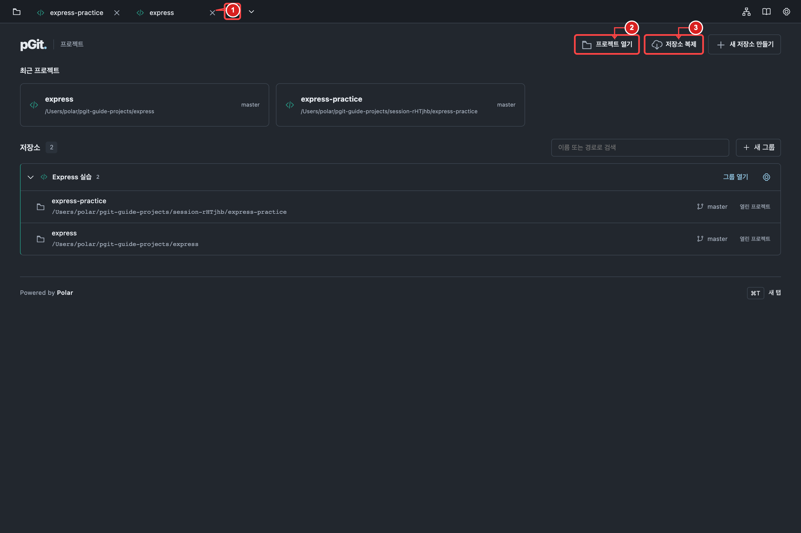

1. 상단 +를 눌러 새 프로젝트 탭을 엽니다.
2. 프로젝트 열기를 누르고 내 컴퓨터의 저장소 폴더를 선택합니다.
3. 원격 주소로 시작하려면 저장소 복제를 누릅니다.

완료 확인: 프로젝트 이름의 탭이 생기고 브랜치와 커밋 이력이 나타납니다. 이미 열린 폴더를 선택하면 기존 탭으로 이동합니다.

알아두기: 홈의 pGit 시작 가이드를 누르면 저장소 준비·이력 확인·변경 선택·커밋과 공유를 4단계로 살펴볼 수 있습니다. 빨간 번호가 붙은 예제 화면을 누르면 확대됩니다. 중간에 닫아도 이어볼 수 있고, 사용 가이드의 시작 가이드 버튼으로 다시 열 수 있습니다. 새 탭 단축키는 Cmd/Ctrl+T입니다. 최근 프로젝트는 마지막에 사용한 3개이며, 아래 목록은 그룹별 전체 저장소입니다. 목록에서 제거해도 프로젝트 파일은 지워지지 않습니다. 새 작업은 새 저장소 만들기에서 폴더를 지정해 시작합니다.

## 02. 저장소 복제 (Clone)

열기: 새 프로젝트 탭 → 저장소 복제를 누릅니다.

### 주소 입력 → 저장 폴더 확인 → 복제

실습 URL은 https://github.com/expressjs/express.git 입니다. Express는 예제 프로젝트의 이름이고, 여기서 배우는 기능은 모든 Git 저장소에 사용하는 Clone입니다.

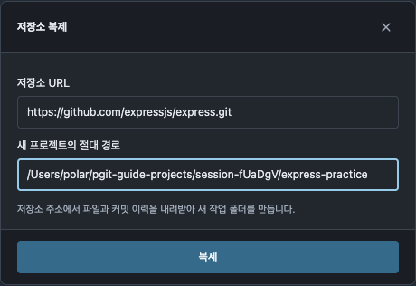

1. 복제할 저장소의 URL을 입력합니다.
2. 내 컴퓨터에 만들 폴더 경로를 확인하거나 수정합니다.
3. 복제를 누릅니다. 완료되면 저장소 탭이 열립니다.

### 진행 상태 확인

진행 중에는 같은 작업을 다시 시작하지 말고 단계와 오류 안내를 확인합니다.

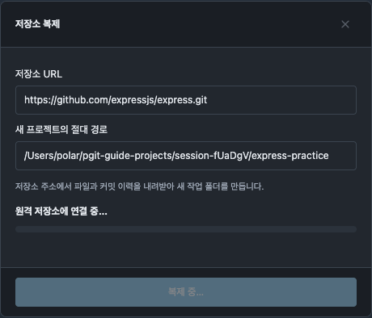

1. 현재 단계와 진행률을 확인하고 완료될 때까지 기다립니다.

완료 확인: 완료되면 복제한 프로젝트가 탭으로 열립니다. 로컬 브랜치와 커밋 이력이 보이면 다음 단계로 이동하세요.

알아두기: URL을 바꾸면 자동 제안 경로도 확인하세요. 직접 수정한 경로는 유지될 수 있습니다. 새 빈 폴더를 지정합니다. 객체 받기·변경분 처리 등 단계가 바뀌면 백분율이 다시 시작할 수 있습니다. 복제는 파일과 Git 이력을 가져오며 패키지 설치나 서버 실행은 별도입니다.

## 03. 프로젝트를 그룹으로 묶기

열기: 홈의 새 그룹 또는 상단 프로젝트 그룹 아이콘을 누릅니다.

### 그룹 이름과 아이콘 선택

AWS 운영, 하나금융, 개인 개발처럼 함께 여는 프로젝트 단위로 이름을 정합니다. 표시된 번호를 따라 입력한 뒤 그룹 만들기 또는 그룹 저장을 누르고, 그룹에 넣을 저장소를 선택합니다.

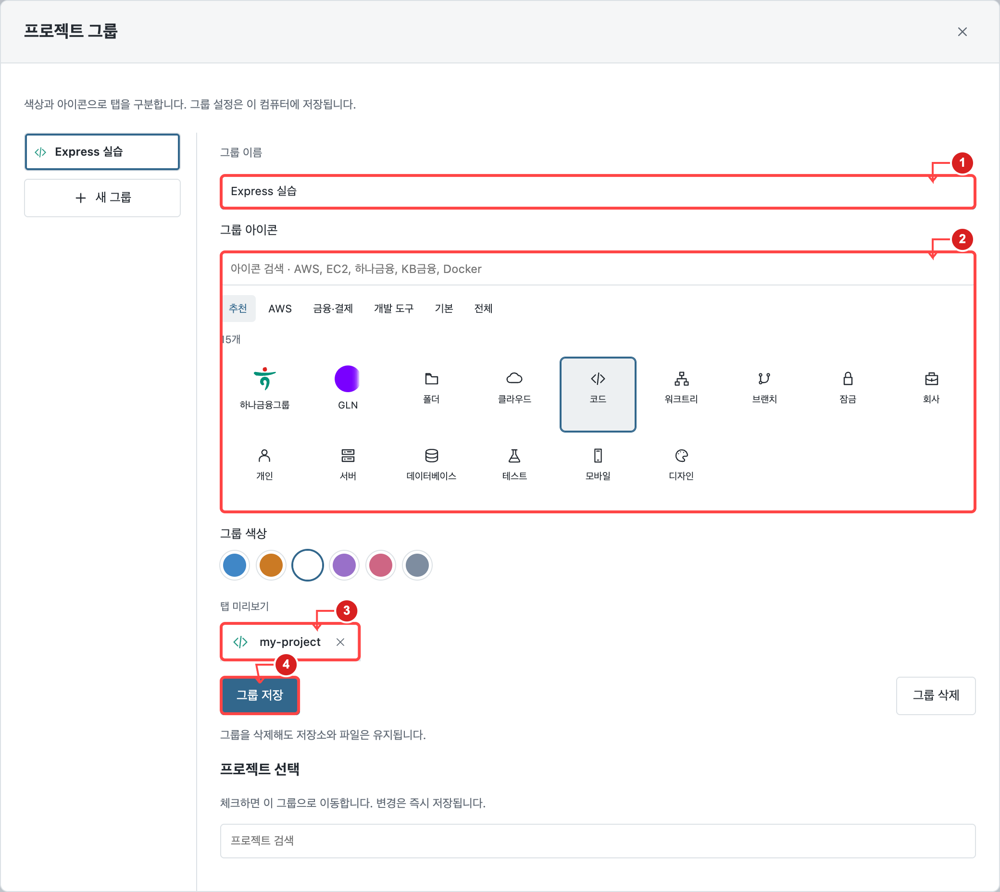

1. 프로젝트를 묶을 그룹 이름을 입력합니다.
2. 아이콘을 선택합니다. 추천에는 하나금융그룹·GLN과 기본 아이콘이 있습니다.
3. 탭에 표시될 이름과 아이콘을 확인합니다.
4. 그룹 저장 버튼을 눌러 진행합니다. 실행 전 대상과 입력값을 다시 확인합니다.

완료 확인: 탭의 프로젝트 이름 왼쪽에 그룹 아이콘이 표시됩니다. 홈의 그룹 열기를 누르면 그 그룹의 프로젝트를 함께 열 수 있습니다.

알아두기: 추천은 하나금융그룹·GLN과 기본 아이콘만 제공합니다. 네이버페이·토스 등은 금융·결제 또는 검색에서 찾습니다. 로고는 대표색을 사용하고, 기본 아이콘은 색상을 직접 고릅니다. 그룹은 앱의 분류이며 Git 브랜치나 폴더를 변경하지 않습니다.

## 04. 커밋 그래프 읽기

열기: 저장소 탭을 열고 왼쪽 로컬 브랜치를 한 번 클릭합니다.

### 브랜치 → 커밋 → 변경 파일

가운데 목록의 한 행이 하나의 커밋입니다. 그래프 선은 부모 커밋과의 연결을 나타냅니다. 오른쪽 상세 정보가 바뀌는지 보며 선택하세요.

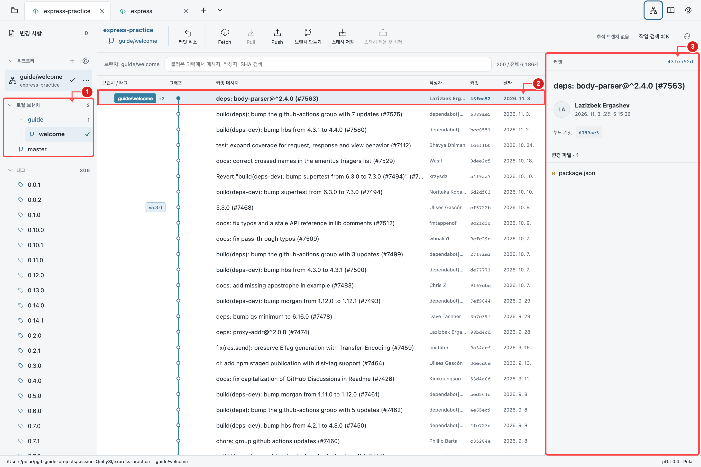

1. 로컬 브랜치를 한 번 눌러 조회할 이력을 선택합니다. 더블클릭은 실제 브랜치 전환입니다.
2. 커밋 행을 누르면 오른쪽에서 메시지와 변경 파일을 볼 수 있습니다.
3. 변경 파일을 눌러 해당 커밋의 Diff를 엽니다.

완료 확인: 선택한 커밋의 메시지·작성자·해시와 변경 파일이 오른쪽에 표시됩니다. 파일을 누르면 변경 전후를 비교할 수 있습니다.

알아두기: 한 번 클릭은 이력 조회, 로컬 브랜치 더블클릭은 실제 전환입니다. 원격이 하나면 로컬과 같은 기준선에 표시하며, 여러 개면 원격별 하위 항목을 들여씁니다. 목록을 아래로 스크롤하면 다음 커밋을 미리 불러옵니다. 전체 개수는 현재 조회 범위 기준입니다.

## 05. 태그와 오래된 릴리스 살펴보기

열기: 왼쪽 태그 영역을 펼칩니다.

### 태그로 조회 범위 바꾸기

예제는 Express의 릴리스 태그입니다. 프로젝트마다 태그 이름과 개수는 다릅니다.

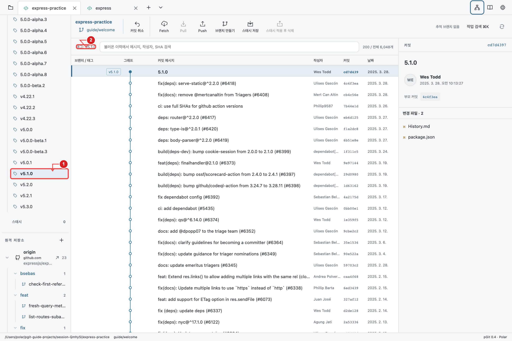

1. 태그를 눌러 그 릴리스까지의 이력을 조회합니다.
2. 현재 조회 기준을 확인합니다. 작업 파일은 바뀌지 않습니다.

완료 확인: 선택한 태그가 가리키는 커밋을 기준으로 과거 이력이 나타납니다. 현재 브랜치 파일은 그대로입니다.

알아두기: 그 버전에서 실제 수정하려면 해당 커밋을 기준으로 새 브랜치를 만들어 전환합니다. 태그는 고정 버전 표식이고 브랜치는 새 커밋에 따라 이동합니다.

## 06. 커밋 검색하고 해당 위치로 이동하기

열기: 작업 검색(Cmd/Ctrl+K) → 전체 이력 메시지 검색을 선택합니다.

### 검색어 입력 → 검색 → 결과 클릭

메시지는 한 줄로 표시됩니다. 그 아래 해시·작성자·날짜를 보고 같은 메시지의 커밋을 구분하세요.

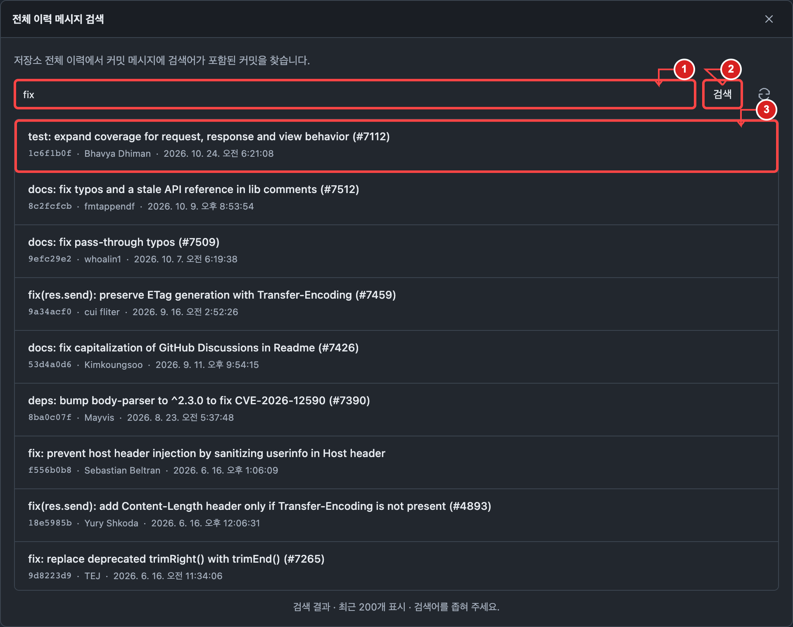

1. 커밋 메시지에서 찾을 검색어를 입력합니다.
2. 검색을 눌러 저장소 전체 이력에서 찾습니다.
3. 결과 행을 눌러 해당 커밋으로 이동합니다.

### 결과가 없을 때 다시 검색

검색 결과가 없다는 안내는 오류가 아닙니다. 다른 검색어를 입력해 다시 시도하세요.

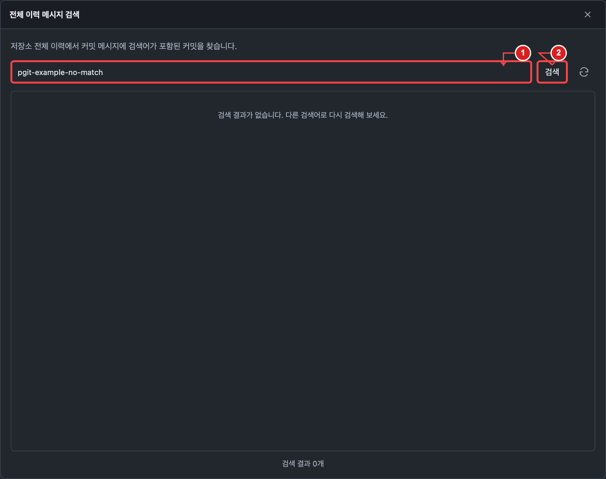

1. 검색어를 더 짧게 바꾸거나 다른 단어를 입력합니다.
2. 검색을 다시 누릅니다. 결과가 없으면 없는 상태가 그대로 안내됩니다.

완료 확인: 결과를 클릭하면 해당 커밋이 선택되고 변경 파일을 확인할 수 있습니다.

알아두기: 그래프 위 일반 검색창은 이미 불러온 이력에서 메시지·작성자·해시를 찾습니다. 전체 이력 메시지 검색은 아직 불러오지 않은 커밋도 찾지만 검색 대상은 메시지입니다. 최대 200개 결과가 나오므로 많으면 검색어를 구체화합니다.

## 07. Diff 읽기와 파일별 이력

열기: 커밋을 선택한 뒤 오른쪽 변경 파일을 누릅니다. 파일 이력은 파일의 메뉴에서 엽니다.

### 변경 전후 비교

삭제·추가 배경과 줄 내부의 강조를 함께 봅니다. 비교 기준과 파일 경로를 먼저 확인하세요.

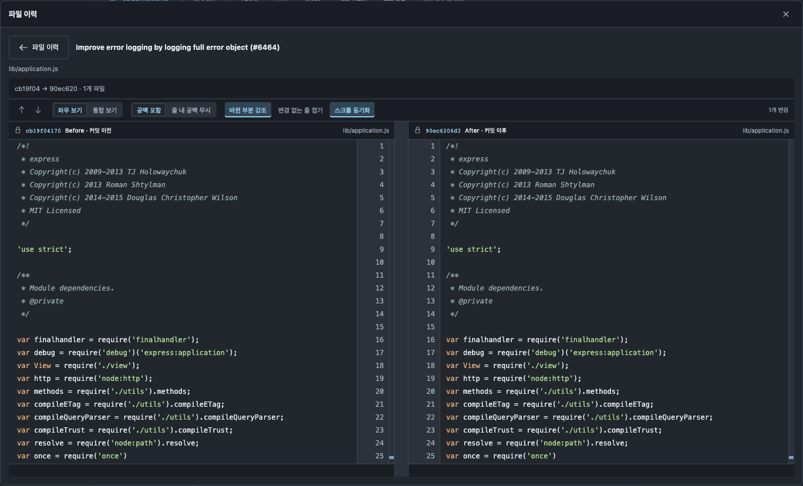

1. 파일 경로와 비교 기준을 먼저 확인합니다.
2. 추가·삭제된 줄과 줄 안의 강조를 비교합니다. 긴 코드는 이 영역을 스크롤합니다.

### 한 파일이 바뀐 커밋 찾기

파일 이력 목록에서 원하는 메시지의 행을 누르면 그 변경을 엽니다.

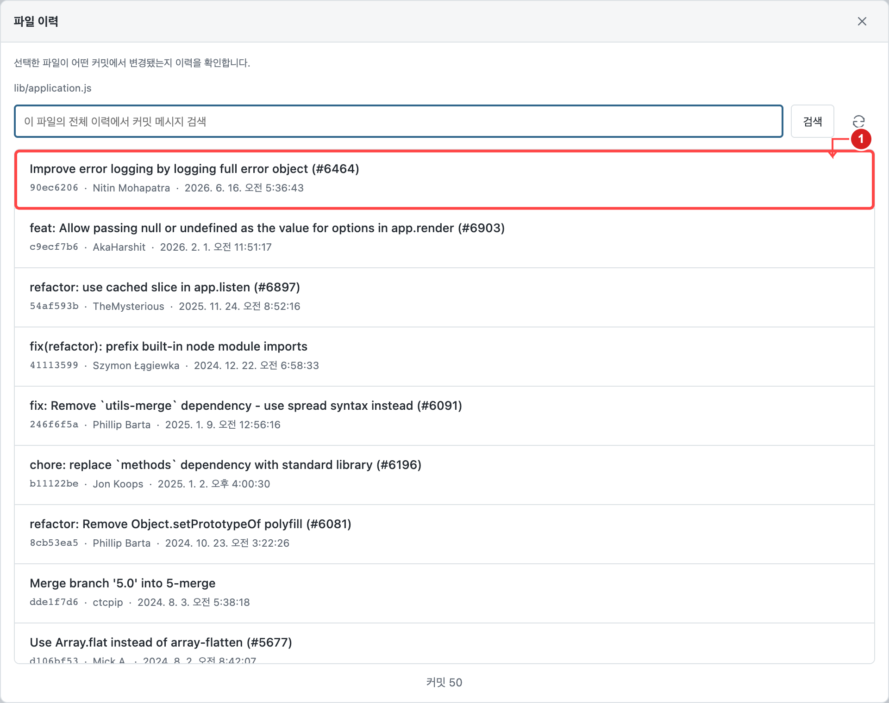

1. 메시지와 날짜를 확인한 뒤 커밋 행을 눌러 이 파일의 변경을 엽니다.

### 줄별 마지막 변경 확인

줄별 작성 이력에서 코드와 해당 줄의 마지막 변경 커밋을 함께 봅니다.

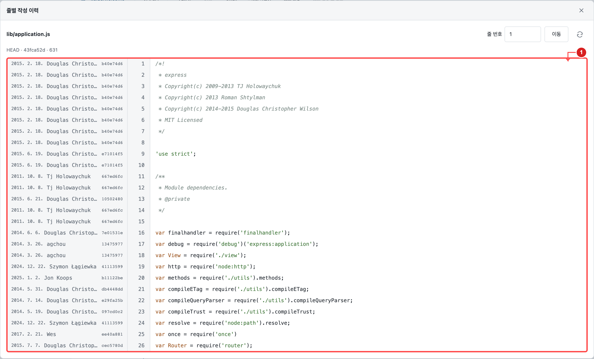

1. 각 줄 옆의 커밋·작성자를 확인합니다. 마지막으로 그 줄을 바꾼 기록입니다.

완료 확인: 파일 전체 이력을 뒤지지 않고 필요한 변경으로 이동할 수 있습니다.

알아두기: 줄별 작성 이력은 최초 작성자를 보장하지 않습니다. 좌우 비교의 동기화 설정은 두 코드 영역의 스크롤을 맞추는 데 사용합니다. 조회 화면은 파일을 수정하지 않습니다.

## 08. 변경 확인부터 첫 커밋까지

열기: 파일을 편집하고 저장한 뒤 저장소 탭의 변경 사항을 누릅니다.

### 커밋에 넣을 변경 검토

예제에서는 lib/application.js와 Readme.md를 수정했습니다. 파일 이름을 눌러 Diff를 확인하고, 파일의 스테이징 동작으로 이번 커밋에 넣을 파일을 고릅니다.

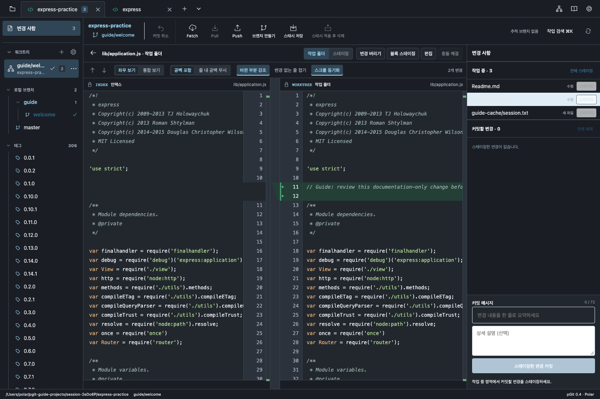

1. 변경 사항을 눌러 작업 중인 파일을 엽니다.
2. 파일 이름을 눌러 변경 내용을 검토합니다.
3. Diff를 확인한 파일의 스테이징 버튼을 눌러 이번 커밋에 포함합니다.

### 스테이징 확인 → 메시지 입력 → 커밋

스테이징 목록만 다음 커밋에 포함됩니다. 목적이 드러나는 메시지를 적습니다. 예: docs: explain the local review workflow

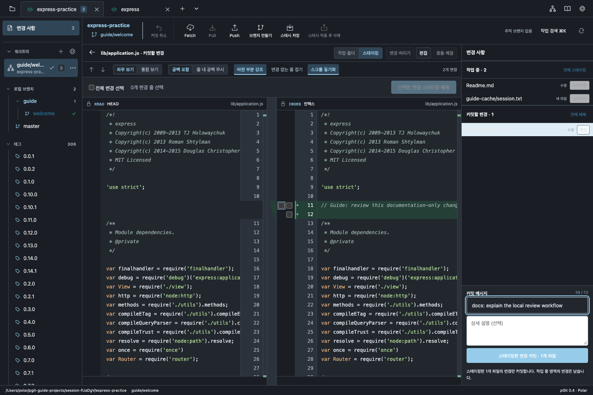

1. 이번 커밋에 들어갈 파일이 맞는지 스테이징 목록을 확인합니다.
2. 변경 목적을 커밋 메시지로 작성합니다.
3. 커밋을 누릅니다. 스테이징한 내용만 로컬 이력에 기록됩니다.

### 커밋 완료 확인

커밋 후 이력에서 방금 입력한 메시지를 찾습니다.

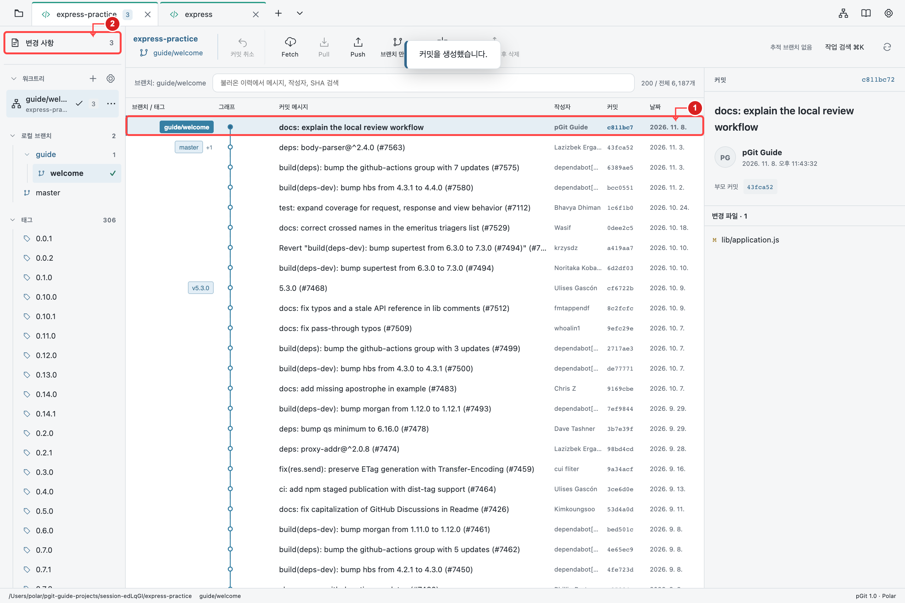

1. 새 메시지의 커밋이 이력 맨 위에 생겼는지 확인합니다.
2. 남겨 둔 변경은 변경 사항에서 계속 작업합니다.

완료 확인: 새 로컬 커밋이 생기고 포함한 변경이 작업 목록에서 빠집니다. 선택하지 않은 변경은 남습니다.

알아두기: 파일 저장, 스테이징, 커밋은 서로 다른 단계입니다. 커밋만으로 원격에 전송되지는 않습니다. 원격으로 보내는 단계는 Push입니다.

## 09. 파일의 일부만 커밋하기

열기: 변경 사항에서 수정한 파일 이름을 눌러 Diff를 엽니다.

### 필요한 줄 선택 → 선택한 변경 스테이징

블록 전체를 넣으려면 블록 체크박스를, 몇 줄만 넣으려면 추가·삭제 줄 옆 체크박스를 사용합니다. 사진은 일부 줄을 선택한 상태입니다. 선택 여부는 체크박스와 옆의 은은한 배경으로 확인합니다. 추가·삭제 배경은 파일 변경 종류를 뜻하며 선택 표시와는 다릅니다.

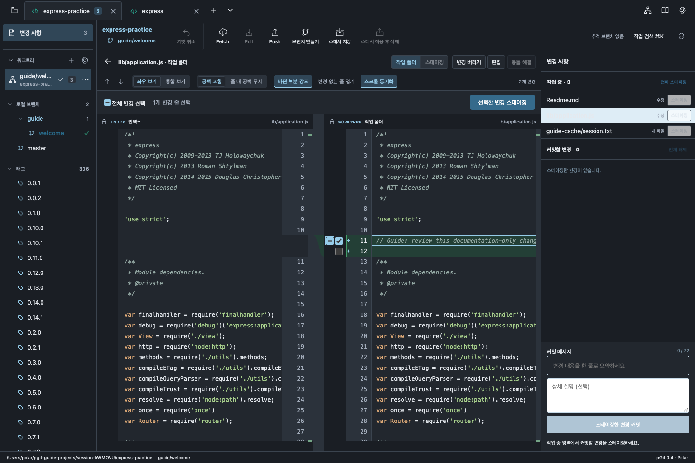

1. 추가·삭제 줄의 체크박스로 이번 커밋에 넣을 줄을 선택합니다.
2. 선택한 변경 스테이징을 눌러 실제로 반영합니다. 체크만으로는 반영되지 않습니다.

완료 확인: 스테이징된 파일을 다시 열어 선택한 줄만 포함됐는지 확인하고 커밋합니다. 나머지는 작업 중인 변경으로 남습니다.

알아두기: 체크만으로는 스테이징되지 않습니다. 스테이징 해제는 커밋 대상에서 빼는 것이고 버리기는 실제 변경을 삭제합니다. 공백 무시 보기에서는 선택할 수 없으므로 공백 포함으로 돌아옵니다. 새 파일·삭제·이름 변경·바이너리는 파일 단위로 처리합니다.

## 10. 파일 생성·편집과 무시 목록

열기: 새 파일은 변경 사항 오른쪽 위의 새 파일을 누르거나 작업 검색 → 새 파일을 엽니다. 저장소 기준 경로(예: src/example.yml)와 내용을 입력하고 파일 만들기를 누릅니다. 없는 폴더는 함께 생성되며 기존 파일을 덮어쓰지 않습니다. 생성 후 작업 중 목록에서 내용을 검토하고 스테이징·커밋하세요. 기존 파일은 변경 파일의 편집을 누릅니다. 기록하지 않을 새 파일은 작업 검색 → 파일 무시를 엽니다.

### 새 파일 → 경로와 내용 입력 → 파일 만들기

변경 사항의 새 파일을 눌러 시작합니다. docs/local-guide.yml처럼 저장소 기준 경로와 내용을 입력하세요. 빈 파일도 만들 수 있으며, 같은 경로의 기존 파일은 덮어쓰지 않습니다.

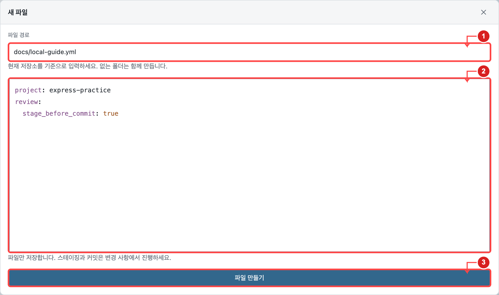

1. 파일 경로를 입력합니다. 예: docs/local-guide.yml. 저장소 안의 상대 경로이며 없는 폴더도 함께 만듭니다.
2. 파일 내용을 입력합니다. 확장자에 맞는 문법 색상으로 표시됩니다.
3. 파일 만들기 버튼을 눌러 진행합니다. 실행 전 대상과 입력값을 다시 확인합니다.

### 생성된 파일 검토 → 스테이징

만든 파일이 작업 중 목록에 나타납니다. 이름을 눌러 내용을 확인하고 이번 커밋에 포함할 때만 스테이징하세요.

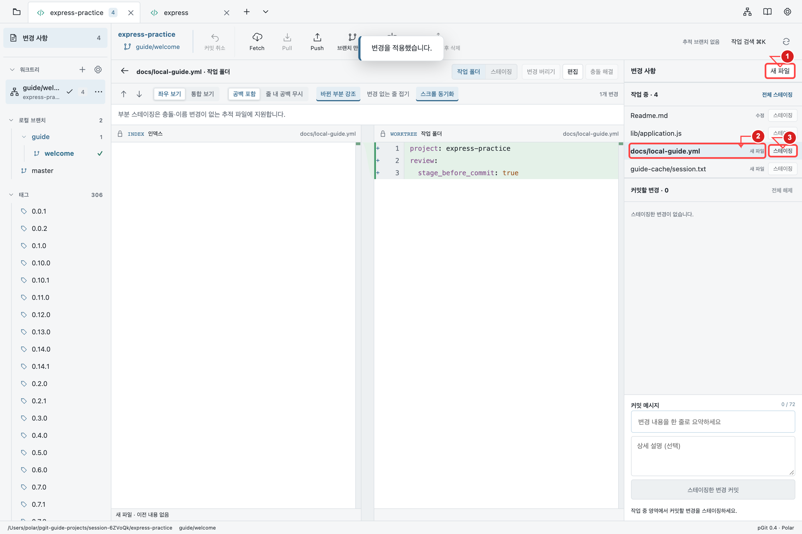

1. 다른 파일을 만들려면 변경 사항의 새 파일을 누릅니다.
2. 생성한 파일이 작업 중 목록에 새 파일로 표시되는지 확인하고 이름을 눌러 내용을 검토합니다.
3. 이번 커밋에 넣으려면 스테이징을 누릅니다. 파일 생성만으로는 커밋되지 않습니다.

### 코드 편집 → 파일 저장

pGit에서 실제 로컬 파일을 직접 수정하는 화면입니다. 확장자에 따른 문법 색상을 보며 수정하고 파일 저장을 누릅니다. 저장 후 Diff에서 의도한 변경인지 확인하세요. 스테이징·커밋은 별도입니다.

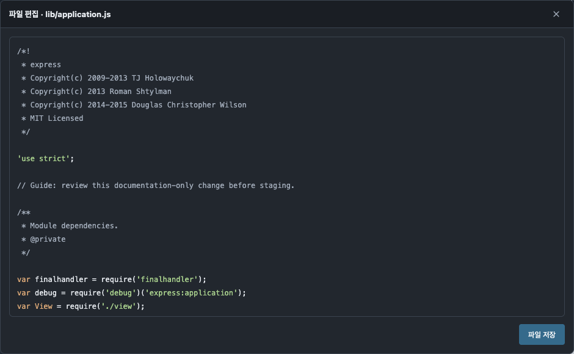

1. 문법 색상을 보며 파일을 편집합니다.
2. 파일 저장 버튼을 눌러 진행합니다. 실행 전 대상과 입력값을 다시 확인합니다.

### 파일 무시 → 제외할 파일·폴더 선택

캐시나 임시 파일을 폴더 트리에서 선택합니다. 예제의 guide-cache는 실습용 폴더입니다.

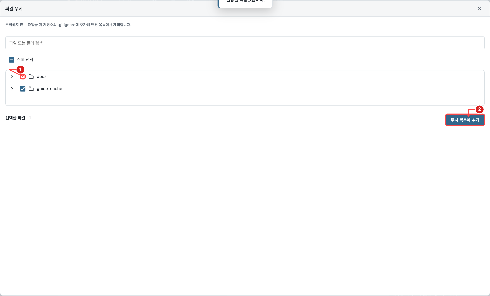

1. 기록하지 않을 파일이나 폴더를 체크합니다.
2. 무시 목록에 추가 버튼을 눌러 진행합니다. 실행 전 대상과 입력값을 다시 확인합니다.

완료 확인: 편집 내용은 작업 파일에 저장됩니다. 무시 목록에 추가하면 .gitignore가 변경되므로 규칙을 검토하고 필요하면 함께 커밋합니다.

알아두기: 이미 추적하는 파일은 .gitignore에 넣는 것만으로 추적이 해제되지 않습니다. 이 화면은 추적하지 않는 파일을 선택하는 용도입니다.

## 11. 커밋 메시지만 수정하기

열기: 그래프의 대상 커밋을 우클릭 → 커밋 메시지 수정을 선택합니다.

### 메시지 수정 → 적용

파일 변경을 추가하지 않고 메시지만 고칩니다. 대상 커밋이 맞는지 확인하세요.

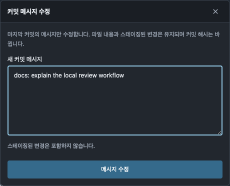

1. 새 커밋 메시지 항목을 확인하고 값을 지정합니다.
2. 메시지 수정 버튼을 눌러 진행합니다. 실행 전 대상과 입력값을 다시 확인합니다.

완료 확인: 이력에 수정한 메시지가 표시됩니다. 스테이징된 변경은 이 작업에 함께 포함되지 않습니다.

알아두기: 과거 커밋을 고치면 해당 커밋과 이후 커밋의 해시가 바뀔 수 있습니다. 이미 공유한 이력은 다른 작업자와 조율합니다. 현재 브랜치와의 관계에 따라 수정할 수 없는 커밋도 있습니다.

## 12. 마지막 커밋에 변경 추가하기

열기: 작업 검색 → 마지막 커밋에 변경 추가를 선택합니다.

### 추가할 파일 선택 → Diff 검토 → 적용

현재 브랜치의 마지막 커밋에 빠뜨린 변경을 넣는 기능입니다. 필요한 파일만 체크하고 메시지도 확인하세요.

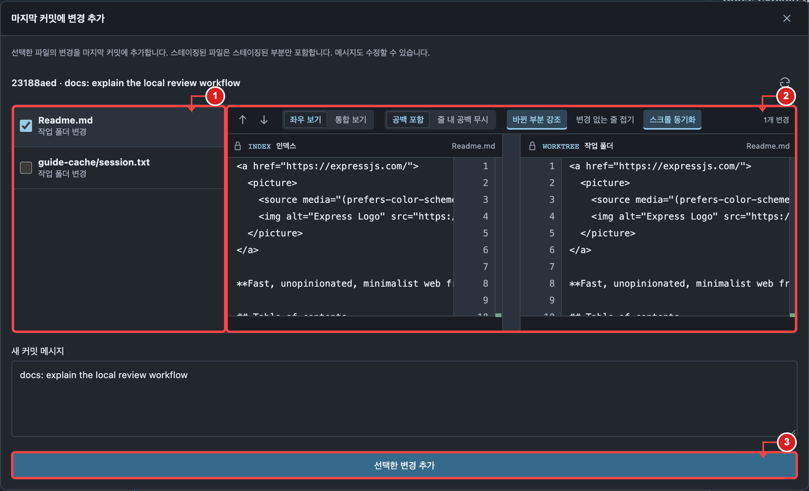

1. 추가할 파일을 체크합니다. 파일 이름을 누르면 Diff를 볼 수 있습니다.
2. 선택한 파일의 변경을 검토합니다.
3. 선택한 변경 추가 버튼을 눌러 진행합니다. 실행 전 대상과 입력값을 다시 확인합니다.

완료 확인: 새 커밋을 하나 더 붙이지 않고 마지막 커밋이 다시 만들어집니다. 새 해시와 포함된 파일을 확인합니다.

알아두기: 이미 스테이징한 파일은 스테이징된 변경 기준으로 반영합니다. 그 외 파일은 화면에 표시된 작업 폴더 변경을 확인합니다. 일부 줄만 넣으려면 먼저 부분 스테이징하세요.

## 13. 브랜치 만들기와 전환하기

열기: 상단 브랜치 만들기를 누릅니다.

### 이름과 시작 지점 지정

guide/my-change처럼 작업 목적을 나타내는 새 이름을 입력합니다. 시작 지점은 선택한 브랜치 또는 커밋입니다.

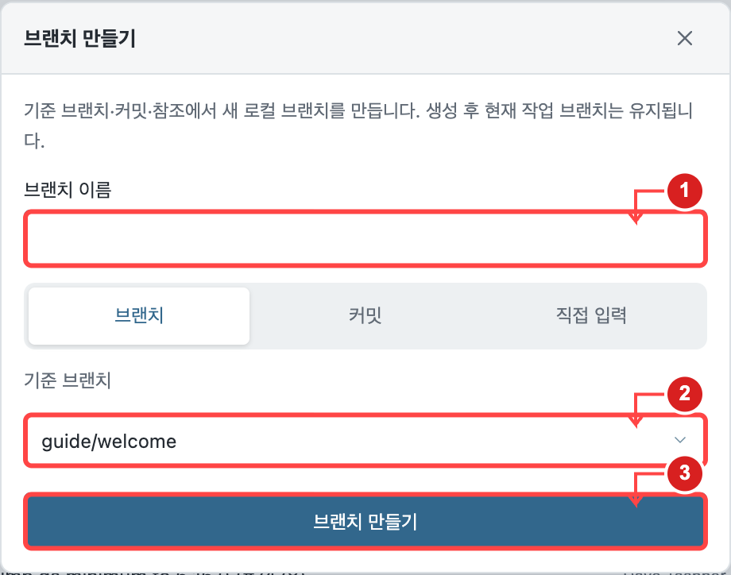

1. 브랜치 이름 항목을 확인하고 값을 지정합니다.
2. 기준 브랜치 항목을 확인하고 값을 지정합니다.
3. 브랜치 만들기 버튼을 눌러 진행합니다. 실행 전 대상과 입력값을 다시 확인합니다.

완료 확인: 왼쪽 로컬 브랜치에 새 이름이 나타납니다. 해당 브랜치를 더블클릭하고 상단 현재 브랜치 이름이 바뀌었는지 확인합니다.

알아두기: 다른 워크트리에서 사용 중인 브랜치는 중복 체크아웃할 수 없습니다. 변경 때문에 전환이 거부되면 먼저 커밋하거나 스태시에 보관합니다.

## 14. 원격 주소와 Fetch · Pull · Push

열기: 주소는 작업 검색 → 원격 주소 보기에서, 동기화는 상단 Fetch·Pull·Push 버튼에서 엽니다.

### 전송 대상 주소 확인

Fetch와 Push 주소가 같으면 하나로, 다르면 각각 표시합니다. 실습 저장소는 외부 전송을 막기 위해 Push 주소를 로컬 경로로 설정했습니다.

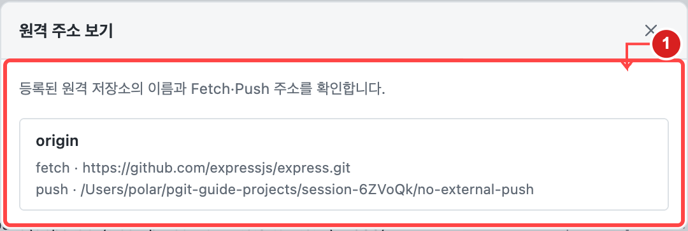

1. 조회 결과를 확인합니다. 등록된 항목이 없으면 빈 상태 안내가 표시됩니다.

### 원격 이력 가져오기

Fetch를 실행한 뒤 원격 브랜치를 눌러 새 커밋을 살펴봅니다. 현재 작업 브랜치에 합치는 동작은 아닙니다.

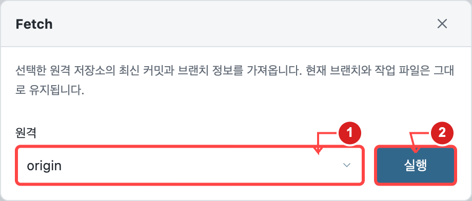

1. 원격 항목을 확인하고 값을 지정합니다.
2. 실행 버튼을 눌러 진행합니다. 실행 전 대상과 입력값을 다시 확인합니다.

### 원격 변경을 현재 브랜치에 반영

현재 브랜치와 추적 원격을 확인합니다. 병합 또는 리베이스 방식을 선택하고 실행합니다.

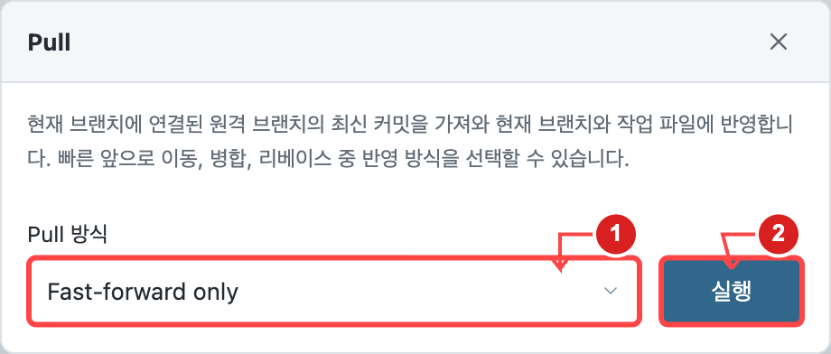

1. Pull 방식 항목을 확인하고 값을 지정합니다.
2. 실행 버튼을 눌러 진행합니다. 실행 전 대상과 입력값을 다시 확인합니다.

### 로컬 커밋을 원격으로 보내기

보낼 브랜치와 원격을 확인하고 실행합니다. 저장하지 않은 편집이나 커밋하지 않은 변경은 전송되지 않습니다.

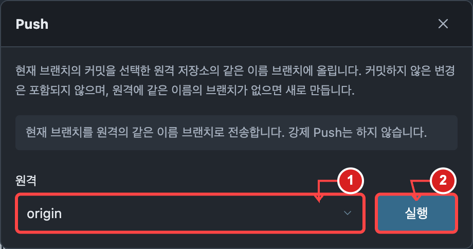

1. 원격 항목을 확인하고 값을 지정합니다.
2. 실행 버튼을 눌러 진행합니다. 실행 전 대상과 입력값을 다시 확인합니다.

완료 확인: Fetch 후 원격 이력이 갱신되고, Pull 후 현재 브랜치에 변경이 반영되며, Push 후 원격에서 새 커밋을 확인할 수 있습니다.

알아두기: 추적 브랜치 없음은 기본 원격 추적 대상이 없다는 뜻입니다. 공개 저장소의 읽기 권한과 Push 권한은 별개입니다. Express 원본으로 Push하지 말고 자신에게 쓰기 권한이 있는 저장소를 사용하세요.

## 15. 브랜치 병합과 충돌 해결

열기: 변경을 받을 브랜치로 먼저 전환한 뒤 작업 검색 → 병합을 엽니다.

### 가져올 브랜치 선택 → 검사 결과 확인 → 병합

가져오는 쪽과 변경을 받는 현재 브랜치의 방향을 확인합니다. 자동 사전 검사는 실제 병합이 아닙니다.

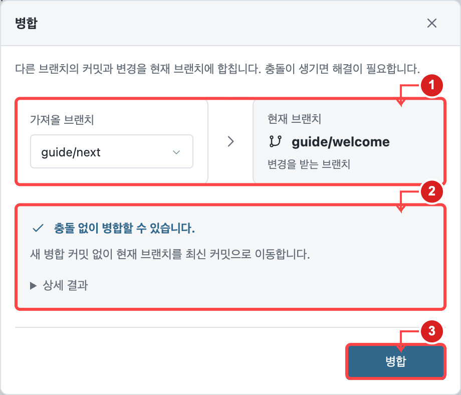

1. 가져올 브랜치를 선택하고 현재 브랜치로 향하는 방향을 확인합니다.
2. 자동 사전 검사 결과를 읽습니다. 이 단계에서는 아직 병합되지 않습니다.
3. 병합 버튼을 눌러 진행합니다. 실행 전 대상과 입력값을 다시 확인합니다.

### 충돌 파일의 최종 내용 결정

변경 사항의 충돌 파일에서 충돌 편집기를 엽니다. 현재 쪽·들어오는 쪽과 최종 결과를 비교하고 필요한 내용으로 편집합니다.

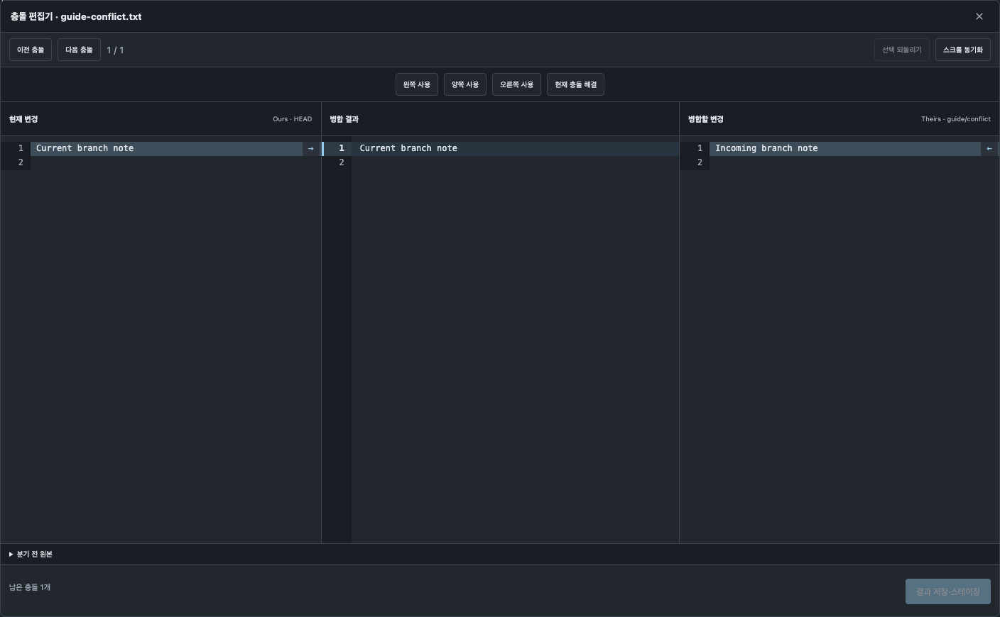

1. 왼쪽·오른쪽·양쪽 중 필요한 내용을 고르거나 결과를 직접 편집합니다.
2. 최종 결과를 검토합니다. 직접 편집했다면 현재 충돌 해결을 눌러 해결 처리합니다. 모든 충돌을 해결하면 저장 버튼이 활성화됩니다.
3. 결과 저장·스테이징 버튼을 눌러 진행합니다. 실행 전 대상과 입력값을 다시 확인합니다.

완료 확인: 충돌 파일을 해결해 저장하고 진행 중인 작업을 계속하면 병합이 완료됩니다. 그래프와 변경 사항에서 결과를 확인합니다.

알아두기: Fast-forward는 새 병합 커밋 없이 브랜치 위치가 앞으로 이동합니다. 충돌을 해결하기 어렵다면 진행 중인 작업의 중단 기능을 사용합니다.

## 16. 작업을 잠시 보관하는 스태시

열기: 상단 스태시 저장을 누릅니다.

### 설명 입력 → 보관

나중에 알아볼 설명을 적습니다. 추적하지 않는 새 파일도 함께 보관합니다. 보관 전 변경 사항 목록을 확인하세요.

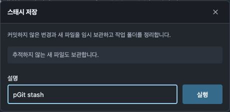

1. 설명 항목을 확인하고 값을 지정합니다.
2. 실행 버튼을 눌러 진행합니다. 실행 전 대상과 입력값을 다시 확인합니다.

완료 확인: 왼쪽 스태시 목록에 항목이 생깁니다. 복원할 때는 항목을 선택해 내용을 확인하고 적용합니다.

알아두기: 적용은 보관 항목을 남깁니다. 적용 후 삭제는 적용이 성공하면 항목도 제거합니다. 다른 변경과 겹치면 충돌할 수 있으므로 복원 후 Diff를 확인하세요.

## 17. 릴리스에 태그 붙이기

열기: 대상 커밋 우클릭 → 태그 만들기 또는 작업 검색 → 태그 만들기를 엽니다.

### 태그 이름과 대상 커밋 확인

v1.0.0처럼 버전을 나타내는 이름을 입력합니다. 이미 있는 이름과 겹치지 않게 지정합니다.

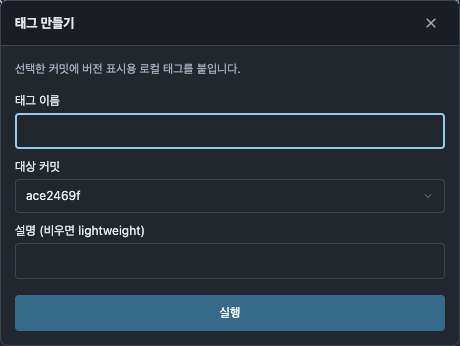

1. 태그 이름 항목을 확인하고 값을 지정합니다.
2. 대상 커밋 항목을 확인하고 값을 지정합니다.
3. 설명 (비우면 lightweight) 항목을 확인하고 값을 지정합니다.
4. 실행 버튼을 눌러 진행합니다. 실행 전 대상과 입력값을 다시 확인합니다.

완료 확인: 왼쪽 로컬 태그 목록에 이름이 생깁니다. 태그를 눌러 의도한 커밋을 가리키는지 확인합니다.

알아두기: 로컬 태그와 원격 태그는 구분됩니다. 로컬 생성·삭제만으로 원격 태그가 바뀌지 않습니다. 필요한 원격 태그 작업은 작업 검색에서 찾습니다.

## 18. 워크트리로 여러 브랜치 동시 작업

열기: 왼쪽 워크트리 영역의 관리 아이콘을 누릅니다.

### 작업 폴더와 사용 중인 브랜치 확인

새 워크트리를 추가할 때 새 작업 폴더와 사용할 브랜치를 지정합니다. 생성한 폴더를 프로젝트로 열어 병렬 작업합니다.

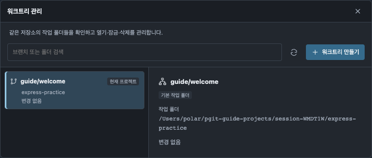

1. 작업 폴더를 선택해 사용 중인 브랜치와 경로를 확인합니다.
2. 브랜치 또는 폴더 이름으로 찾을 수 있습니다.
3. 워크트리 만들기 버튼을 눌러 진행합니다. 실행 전 대상과 입력값을 다시 확인합니다.

완료 확인: 같은 Git 이력을 공유하면서 서로 다른 브랜치를 별도 폴더에서 작업할 수 있습니다.

알아두기: 이미 사용 중인 브랜치 오류에 경로가 나오면 해당 워크트리를 여세요. 제거 전 미커밋 변경을 확인합니다. 잠금은 자동 정리를 막는 기능이며 편집 권한 설정이 아닙니다.

## 19. 커밋 이력 정리하기

열기: 작업 검색 → 커밋 이력 정리를 엽니다.

### 먼저 정리할 범위 선택

첫 커밋을 고르면 현재 브랜치의 최신 커밋까지 함께 선택됩니다. 범위를 확인한 다음 편집 단계로 넘어갑니다.

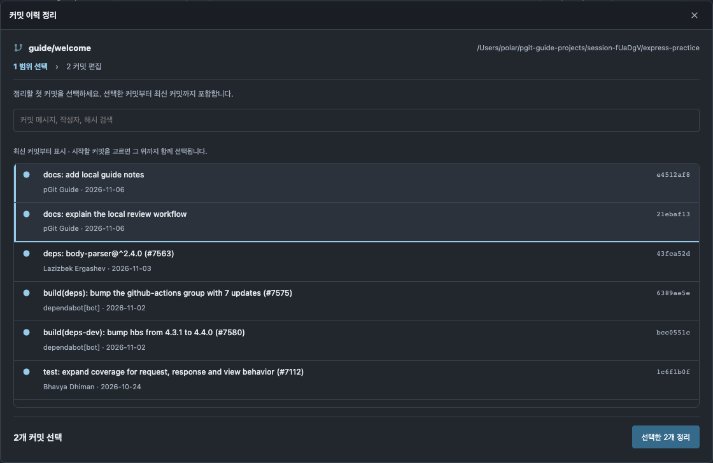

1. 정리할 첫 커밋을 선택합니다. 해당 커밋부터 최신 커밋까지 포함됩니다.
2. 선택한 범위를 확인하고 선택한 커밋 정리를 누릅니다.

### 커밋별 작업 지정 → 결과 미리보기 → 적용

행을 선택해 메시지 수정·이전과 합치기·제외·순서 이동을 지정합니다. 오른쪽 적용 후 이력이 의도한 순서와 메시지인지 확인합니다.

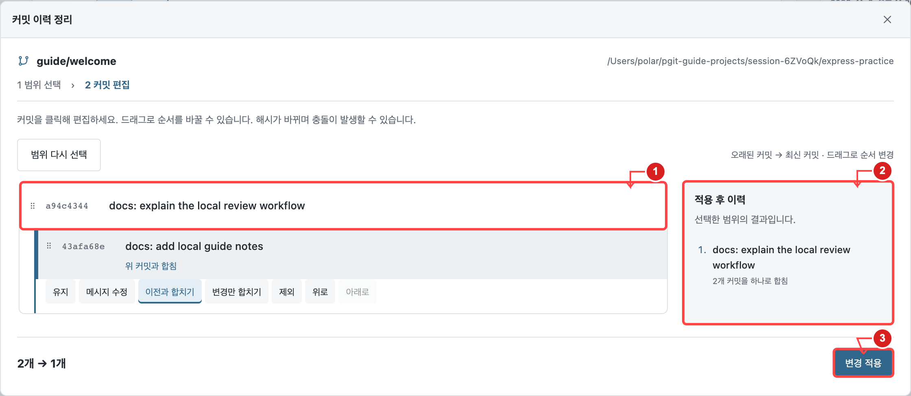

1. 정리할 커밋 행을 눌러 작업을 선택합니다.
2. 오른쪽 미리보기에서 적용 후 커밋 수와 메시지 순서를 확인합니다.
3. 적용 후 이력을 확인한 뒤 변경 적용을 누릅니다.

완료 확인: 적용한 뒤 그래프에서 커밋 수·순서·메시지를 확인합니다. 합친 커밋은 하나의 기록으로 나타납니다.

알아두기: 이력 재작성으로 해시가 바뀝니다. 상단 안내에서 정리 가능한 개수와 제한 이유를 확인합니다. 병합 커밋을 포함한 범위와 첫 커밋은 선택할 수 없으며, 각 행에 이유가 표시됩니다. 일반 병합의 원래 커밋은 그래프에 남아 있습니다. 메시지만 바꾸려면 그래프에서 커밋을 우클릭해 커밋 메시지 수정을 선택합니다. 변경을 다시 적용하다 충돌이 나면 해결하고 계속하거나 작업을 중단합니다.

## 20. Cherry-pick · Revert · Reset 구분하기

열기: 그래프에서 대상 커밋을 우클릭해 필요한 동작을 선택합니다.

### 다른 커밋의 변경 가져오기

선택한 변경을 현재 브랜치 위에 새 커밋으로 적용합니다. 다른 브랜치의 수정 하나가 필요할 때 사용합니다.

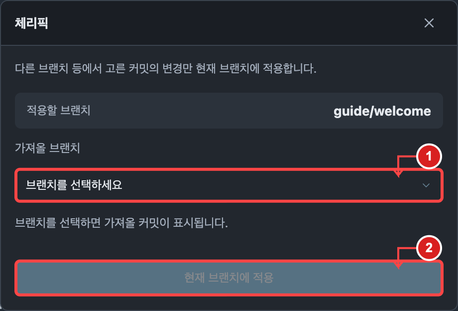

1. 가져올 브랜치 항목을 확인하고 값을 지정합니다.
2. 현재 브랜치에 적용 버튼을 눌러 진행합니다. 실행 전 대상과 입력값을 다시 확인합니다.

### 기록을 남기면서 변경 취소

대상 커밋의 변경을 반대로 적용하는 새 커밋을 만듭니다. 기존 커밋 자체를 지우지 않습니다.

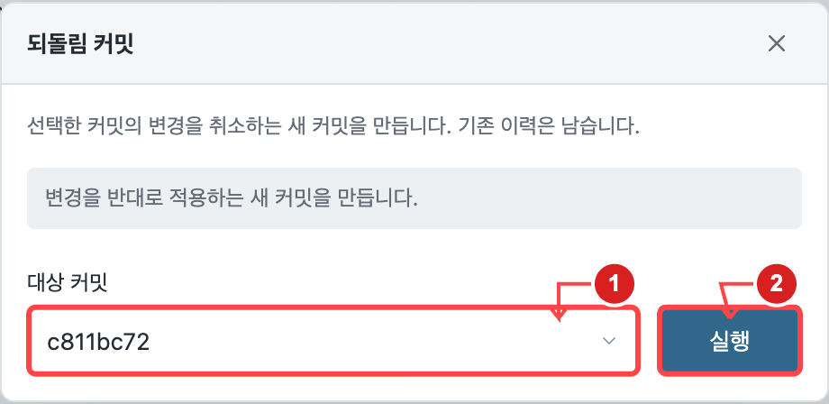

1. 대상 커밋 항목을 확인하고 값을 지정합니다.
2. 실행 버튼을 눌러 진행합니다. 실행 전 대상과 입력값을 다시 확인합니다.

### 브랜치 위치와 파일 영향 확인

대상 커밋과 방식을 검토한 후 실행합니다. Soft는 변경을 스테이징에, Mixed는 작업 폴더에 남깁니다. Hard는 파일도 대상 커밋 상태로 바꿉니다.

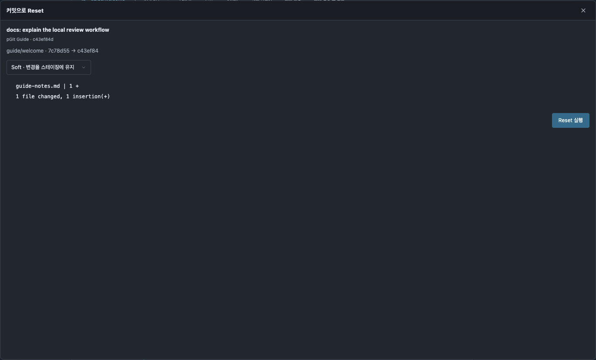

1. Reset 방식을 선택합니다. Soft·Mixed·Hard의 파일 영향을 확인합니다.
2. 대상 커밋으로 이동할 때 바뀌는 내용을 확인합니다.
3. Reset 실행 버튼을 눌러 진행합니다. 실행 전 대상과 입력값을 다시 확인합니다.

완료 확인: Cherry-pick과 Revert는 새 커밋을, Reset은 이동한 브랜치 위치와 남은 파일 변경을 확인합니다.

알아두기: 세 기능은 서로 대체 관계가 아닙니다. 특히 Hard Reset은 작업 변경을 잃을 수 있으므로 파일 영향과 확인 항목을 읽고 실행합니다.

## 21. Reflog로 이전 위치 찾기

열기: 작업 검색 → Reflog를 엽니다.

### 최근 브랜치 이동 기록 확인

커밋·전환·Reset 전후의 해시와 설명을 찾습니다. 되돌아가려는 위치의 해시를 먼저 확인하세요.

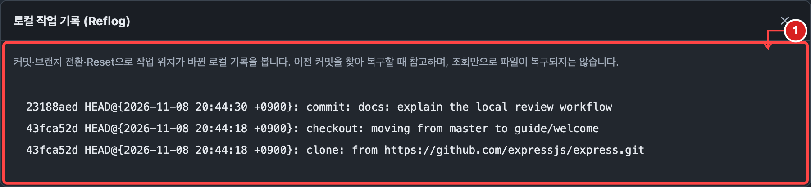

1. 조회 결과를 확인합니다. 등록된 항목이 없으면 빈 상태 안내가 표시됩니다.

완료 확인: 필요한 이전 커밋을 찾았다면 그 위치에 새 브랜치를 만들어 내용을 확인할 수 있습니다.

알아두기: Reflog는 이 컴퓨터의 로컬 이동 기록입니다. 모든 삭제 파일의 백업은 아니며 영구 보존도 보장하지 않습니다. 커밋되지 않은 파일을 항상 복원할 수 있는 기능은 아닙니다.

## 22. 서브모듈 상태 확인하기

열기: 작업 검색 → Submodule 상태를 선택합니다.

### 등록된 하위 저장소 확인

별도 저장소를 특정 커밋에 고정해 포함하는 기능입니다. 공통 라이브러리나 프레임워크를 이런 구조로 관리할 때 사용합니다.

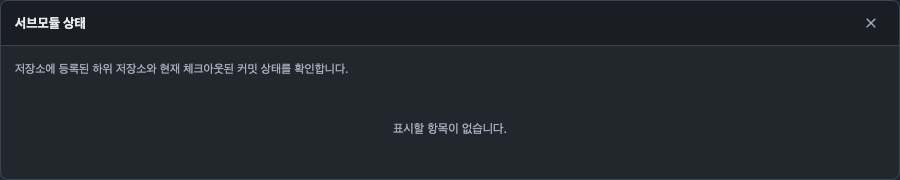

1. 조회 결과를 확인합니다. 등록된 항목이 없으면 빈 상태 안내가 표시됩니다.

완료 확인: 등록된 하위 저장소와 상태가 표시됩니다. Express 예제에는 없으므로 빈 상태 안내가 나타납니다.

알아두기: 등록된 서브모듈을 내려받거나 기록된 버전에 맞추려면 Submodule 초기화·갱신을 사용합니다. 일반 폴더나 패키지 매니저 의존성이 자동으로 서브모듈이 되지는 않습니다.

## 23. 작성자와 화면 설정

열기: 작성자는 작업 검색 → 저장소 작성자 설정, 앱 표시는 상단 톱니바퀴에서 엽니다.

### 앞으로 만들 커밋의 작성자 지정

이름과 이메일을 입력하고 저장합니다. 이 저장소에 적용됩니다.

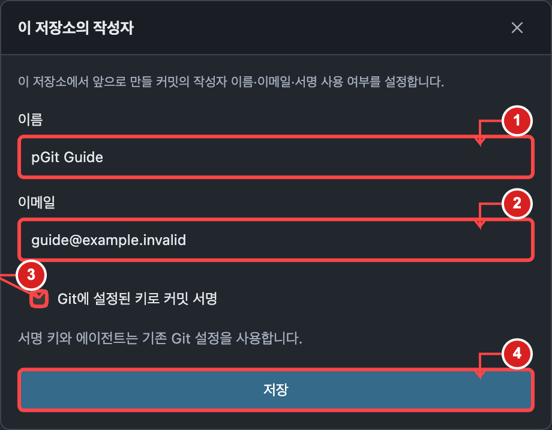

1. 이름 항목을 확인하고 값을 지정합니다.
2. 이메일 항목을 확인하고 값을 지정합니다.
3. Git에 설정된 키로 커밋 서명 항목을 확인하고 값을 지정합니다.
4. 저장 버튼을 눌러 진행합니다. 실행 전 대상과 입력값을 다시 확인합니다.

### 테마 선택

상단 설정을 열어 밝기와 색상을 고릅니다. 프로젝트의 코드나 Git 이력에는 영향을 주지 않습니다.

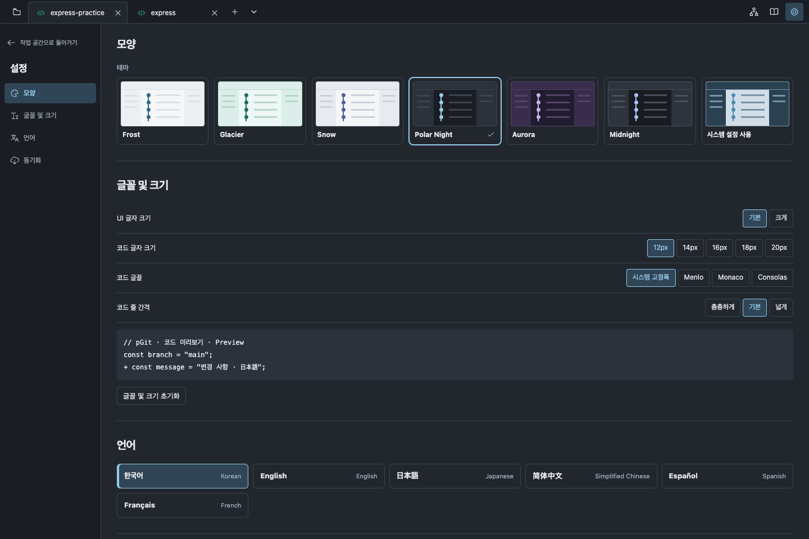

1. 설정에서 화면 항목을 엽니다.
2. 사용할 테마를 누릅니다. 즉시 반영됩니다.

### 글꼴과 크기 조절

코드 글꼴·크기·줄 간격을 바꾸고 미리보기를 확인합니다.

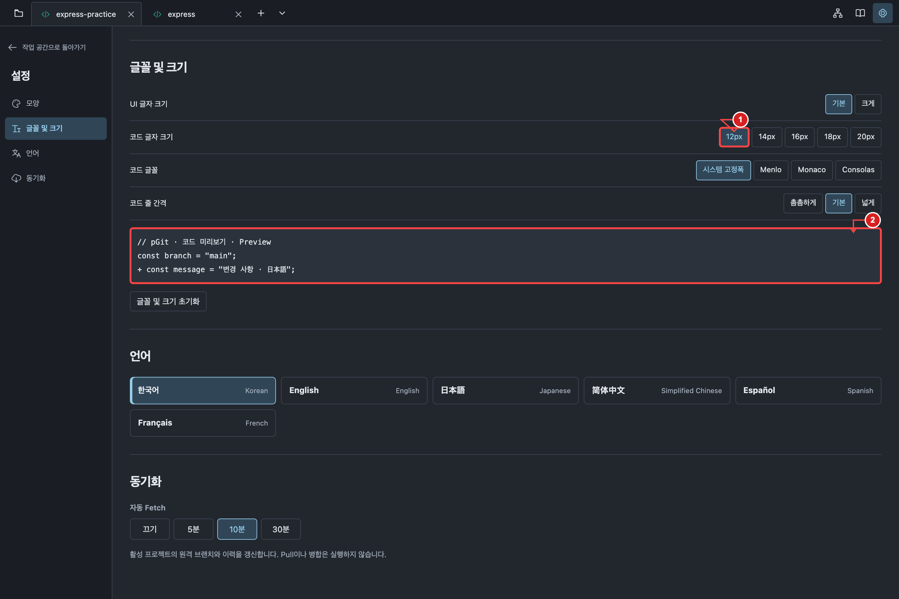

1. 코드 글자 크기를 선택합니다.
2. 미리보기에서 코드가 읽기 편한지 확인합니다.

### 원격 갱신 주기 설정

자동 Fetch는 원격 정보를 확인하는 기능입니다. 필요하면 끄거나 간격을 늘릴 수 있습니다.

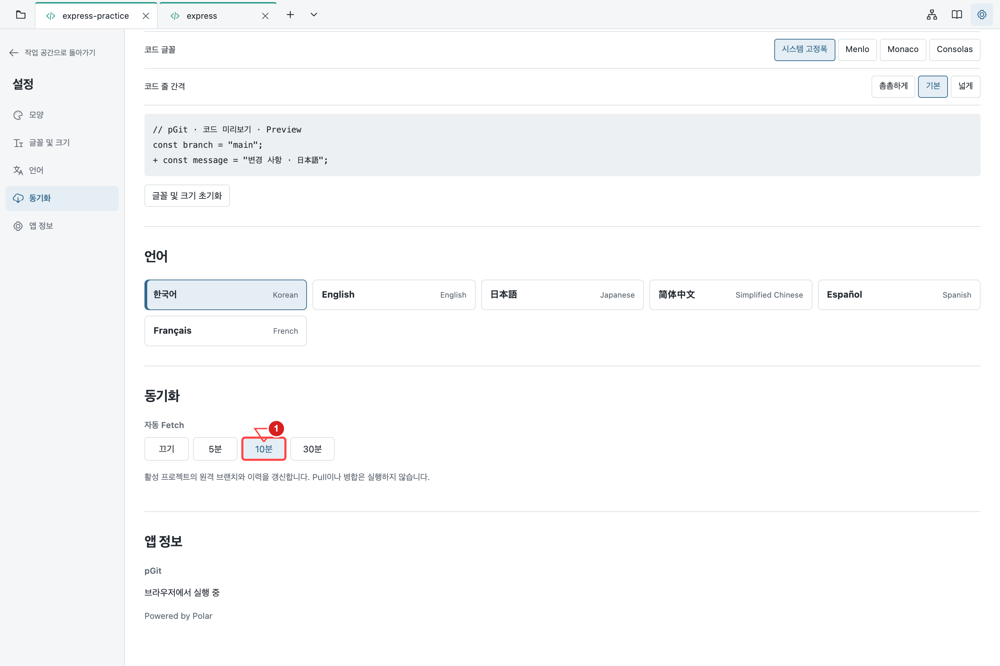

1. 자동 Fetch 주기를 선택합니다. 원격 정보만 갱신하며 자동 Pull은 하지 않습니다.

완료 확인: 화면 설정은 즉시 반영됩니다. 작업 화면으로 돌아가 실제 코드와 목록이 읽기 편한지 확인하세요.

알아두기: 작성자 설정은 기존 커밋의 작성자를 바꾸지 않습니다. 서명 옵션은 기존 Git 키·에이전트 설정을 사용합니다. 자동 Fetch는 자동 Pull이나 자동 병합이 아닙니다.

## 24. 작업 검색과 문제 해결

열기: 저장소에서 Cmd/Ctrl+K 또는 상단 작업 검색을 누릅니다.

### 기능 이름으로 작업 찾기

병합, 파일 이력, 작성자처럼 하려는 작업을 검색합니다. 결과를 누르면 해당 입력 또는 조회 화면으로 이동합니다.

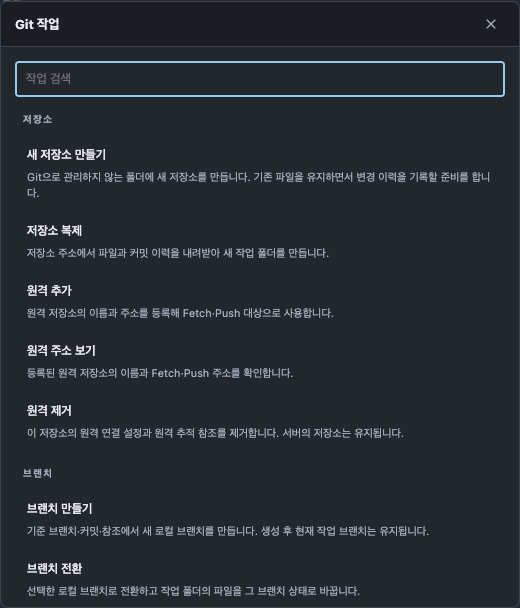

1. 실행할 작업의 이름을 입력합니다.
2. 검색 결과에서 원하는 작업을 누르면 해당 화면이 열립니다.

### 다른 표현으로 같은 작업 찾기

메뉴 이름을 정확히 기억할 필요는 없습니다. 파일 추가 → 새 파일, 브랜치 추가 → 브랜치 만들기, 커밋 제목 수정 → 커밋 메시지 수정처럼 검색할 수 있습니다. 검색 별칭은 결과에 따로 나열하지 않습니다. 띄어쓰기와 영문 대소문자도 구분하지 않습니다.

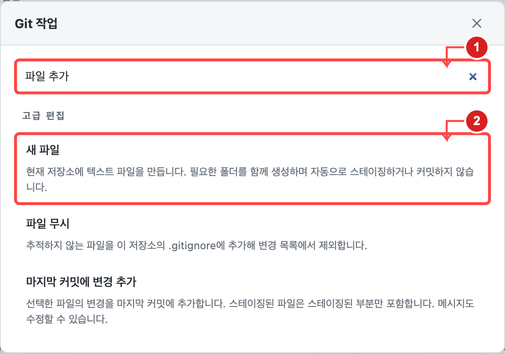

1. 파일 추가처럼 익숙한 표현으로 검색합니다. 파일 생성·파일생성·add file도 사용할 수 있습니다.
2. 검색 결과의 새 파일을 누릅니다. 표현이 달라도 같은 파일 생성 화면으로 이동합니다.

완료 확인: 원하는 기능을 찾으면 앞 장의 해당 절차로 이어서 진행합니다. 이미 선택한 파일·커밋이 있다면 우클릭 메뉴로 여는 편이 대상을 지정하기 쉽습니다.

알아두기: GitHub·GitLab 전용 리뷰·이슈 연동 항목은 현재 작업 검색에서 숨겨져 있습니다. 일반 Clone·Fetch·Pull·Push는 사용할 수 있습니다. Git LFS는 현재 제공하지 않습니다.

### 막혔을 때 확인할 것

- Git을 찾을 수 없음: Git 실행 파일 설치와 경로를 확인한 뒤 앱을 다시 시작합니다. 저장소 경로 오류와는 다릅니다.
- 복제 실패: URL, 접근 권한, 네트워크, 빈 저장 폴더와 여유 공간을 확인합니다. 오류 상세 내용을 읽고 원인을 해결한 뒤 다시 시도합니다.
- 브랜치 전환 실패: 다른 워크트리가 사용 중인지, 작업 변경이 덮어써지는지 확인합니다. 오류에 나온 작업 폴더를 열거나 변경을 먼저 커밋·스태시합니다.
- 원하는 커밋이 안 보임: 조회 중인 브랜치·태그와 검색어를 확인합니다. 전체 메시지 검색으로 아직 불러오지 않은 커밋도 찾습니다.
- 폴더 없음: 최근 프로젝트의 저장된 경로가 현재 존재하지 않는 상태입니다. 실제 위치에서 프로젝트를 다시 엽니다.

### 자주 쓰는 단축키

- Cmd/Ctrl+T: 새 프로젝트 탭.
- Cmd/Ctrl+K: 작업 검색.
- Cmd/Ctrl+,: 설정.
- Esc: 열린 창 닫기. 실행 중인 작업은 닫기가 제한될 수 있습니다.
- 상단 책 아이콘: 이 가이드. 그림 클릭: 확대.
