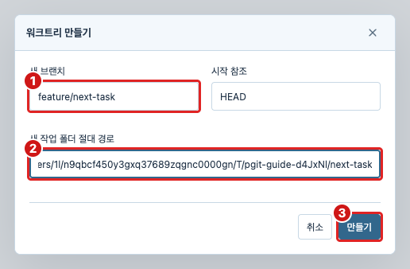

# pGit 사용 가이드

이 문서는 현재 pGit의 화면과 기능을 기준으로 작성한 한국어 가이드입니다. 우측 상단의 책 아이콘에서 같은 내용을 읽을 수 있습니다. 가이드를 닫아도 작업 파일과 작성 중인 커밋 메시지는 유지됩니다.

## 화면으로 따라 하기

아래 이미지는 가상 디자인이 아니라 pGit을 실행하고 샘플 저장소 `arctic-demo`에서 직접 파일 선택, 스테이징, 커밋, 워크트리 생성을 진행한 화면입니다. 개인 프로젝트를 건드리지 않도록 임시 저장소에서 촬영했습니다. 빨간 테두리는 조작할 영역, 빨간 숫자는 아래 설명의 순서입니다. 앱에서는 이미지를 누르면 원본 크기로 확대할 수 있습니다.

## 처음 시작하기

1. 상단의 `+`를 눌러 프로젝트를 추가합니다.
2. `로컬 열기`는 기존 Git 저장소의 폴더를 선택합니다. `복제`는 원격 URL과 새 폴더 경로를 입력합니다. `새로 만들기`는 새 폴더에 Git 저장소를 만듭니다.
3. 프로젝트는 각각의 탭에서 열립니다. 탭을 선택해 전환하고, 탭의 `×`로 닫습니다.
4. 처음에는 현재 브랜치의 커밋 이력이 표시됩니다. 변경된 파일을 보려면 왼쪽 `변경 사항`을 선택합니다.

1. 빨간 ①에서 `로컬 열기`를 선택합니다. 복제할 때는 옆의 `복제`를 선택합니다.
2. 빨간 ②에 실제 저장소 폴더를 입력하거나 찾아보기로 선택합니다. 사진 속 임시 경로를 그대로 입력하지 마세요.
3. 빨간 ③ `프로젝트 열기`를 눌러 새 탭을 엽니다.

GitHub나 GitLab 계정 없이도 로컬 이력과 변경을 확인할 수 있습니다. 원격 작업에는 해당 서버의 Git 인증이 필요합니다.

## 화면 구성과 브랜치 탐색

- 상단 탭: 여러 프로젝트를 전환합니다. 폴더 아이콘은 프로젝트 홈입니다.
- 왼쪽: 변경 사항, 워크트리, 로컬 브랜치, 태그, 스태시, 원격 저장소를 탐색합니다.
- 가운데: 선택한 브랜치의 이력 또는 파일 Diff를 표시합니다.
- 오른쪽: 선택한 커밋의 정보와 변경 파일, 또는 스테이징과 커밋 입력 영역을 표시합니다.

왼쪽 브랜치를 한 번 클릭하면 그 브랜치의 이력을 봅니다. 이 동작은 체크아웃이 아닙니다. 실제 작업 브랜치를 바꾸려면 상단의 현재 브랜치 버튼에서 전환합니다. 전환 전에 작업 중인 변경을 커밋하거나 스태시로 보관하세요.

상단의 현재 브랜치 버튼을 누르면 이 창이 열립니다. 빨간 ①에서 대상 브랜치를 검색·선택하고, 빨간 ②를 눌러 실제로 전환합니다. 왼쪽 목록에서 이력만 보는 동작과 다릅니다. 촬영 시에는 커밋하지 않은 `README.md`가 남아 있어 전환을 실행하지 않고 창을 닫았습니다.

`codex/feature`처럼 `/`가 있는 브랜치는 접두사별로 묶입니다. 화살표로 그룹을 접고 펼칩니다. 항목이 없는 목록에는 펼침 화살표를 표시하지 않습니다. 브랜치의 추가 작업은 우클릭 메뉴 또는 작업 검색에서 찾을 수 있습니다.

## 변경 검토와 커밋

1. `변경 사항`을 열고 작업 중인 파일을 선택합니다.
2. Diff에서 수정 내용을 확인합니다.
3. 커밋에 넣을 파일을 스테이징합니다. 모든 파일을 넣을 때는 `전체 스테이징`, 다시 검토할 때는 `전체 해제`를 사용합니다.
4. 커밋 메시지를 입력합니다. 필요한 경우 상세 설명도 작성합니다.
5. 스테이징한 변경을 커밋합니다. 스테이징하지 않은 변경은 작업 폴더에 남습니다.

1. 빨간 ① `변경 사항`을 클릭합니다.
2. 빨간 ② `src/greeting.js`를 클릭해 가운데 Diff를 읽습니다.
3. 이 파일의 변경을 모두 다음 커밋에 넣으려면 빨간 ③ `스테이징`을 클릭합니다. 일부만 넣으려면 상단의 `블록 스테이징`을 사용하세요.

1. 빨간 ①에 커밋할 파일이 들어왔는지 확인합니다. 예제에서 `README.md`는 작업 중 영역에 남겨 둡니다.
2. 빨간 ②에 이번 커밋의 목적을 적습니다.
3. 빨간 ③을 누릅니다. 이 예제는 실제로 실행했으며 `src/greeting.js`만 커밋되고 `README.md` 수정은 남았습니다.

스테이징은 다음 커밋에 넣을 변경을 고르는 단계입니다. 커밋은 로컬 저장소에 기록하며, 원격 서버에 보내는 Push는 별도 작업입니다.

한 파일에서 일부만 커밋하려면 `블록 스테이징`으로 변경 블록 또는 줄을 선택합니다. 먼저 선택한 부분을 스테이징하고 커밋한 뒤 나머지를 다음 커밋으로 나눌 수 있습니다. `편집`은 실제 작업 폴더의 파일 내용을 수정하는 기능입니다.

## Diff 읽기

- `좌우 보기`: 왼쪽은 변경 전, 오른쪽은 변경 후입니다. 줄 번호와 가운데 연결 영역으로 대응하는 변경을 확인합니다.
- `통합 보기`: 삭제된 줄과 추가된 줄을 하나의 화면에서 함께 봅니다.
- 위·아래 화살표: 이전 변경 또는 다음 변경 위치로 이동합니다.
- `공백 포함`: 공백과 탭의 차이도 변경으로 표시합니다.
- `줄 내 공백 무시`: 줄 안의 공백·탭 차이를 비교 표시에서 무시합니다. 파일 자체는 변경하지 않습니다.
- `바뀐 부분 강조`: 수정된 줄 안에서 달라진 단어를 강조합니다.
- `변경 없는 줄 접기`: 긴 공통 구간을 접고 변경 주변을 남깁니다. 접힌 줄 수를 눌러 펼칠 수 있습니다.
- `스크롤 동기화`: 좌우 비교 화면을 함께 스크롤합니다.

1. 빨간 ①은 변경 전후를 나란히 보여 줍니다.
2. 빨간 ②로 바꾸면 삭제·추가 줄을 한 화면에서 봅니다.
3. 빨간 ③으로 다음 변경 위치에 이동합니다. 왼쪽 위 화살표는 이전 변경입니다.
4. 빨간 ④를 켜고 끄며 줄 안에서 달라진 단어를 확인합니다.

커밋 이력에서 파일을 선택하면 해당 커밋의 변경 전후를 비교합니다. `크게 보기`로 비교 영역을 넓힐 수 있습니다. 코드 글꼴과 줄 간격은 설정에서 별도로 조절합니다.

## 이력 검색과 커밋 상세

1. 왼쪽에서 확인할 브랜치를 선택합니다.
2. 이력 위 검색창에 커밋 메시지, 작성자 또는 SHA를 입력합니다. 검색은 현재 불러온 이력 범위에서 수행됩니다.
3. 커밋 행을 선택하면 오른쪽에 메시지, 작성자, 날짜, 부모 커밋과 변경 파일이 나타납니다.
4. 변경 파일을 선택해 Diff를 확인합니다. 부모 커밋 해시를 누르면 해당 커밋으로 이동합니다.

1. 빨간 ①은 앞 단계에서 만든 실제 커밋입니다. 선택하면 오른쪽 상세 정보가 바뀝니다.
2. 빨간 ②에서 메시지를 확인합니다.
3. 빨간 ③의 변경 파일을 클릭하면 해당 커밋의 Diff로 이동합니다. 예제에서는 커밋한 파일만 나타납니다.

더 넓은 범위의 메시지를 찾을 때는 작업 검색의 `전체 이력 메시지 검색`을 사용할 수 있습니다. 커밋 선택과 이력 탐색만으로 작업 폴더의 파일이 바뀌지는 않습니다.

## 원격 저장소와 동기화

원격 저장소 제목 옆 `+`에서 원격 이름과 URL을 추가합니다. `origin`, `upstream` 등 여러 원격을 각각 관리할 수 있습니다. 원격 아래 브랜치는 Fetch로 가져온 원격 추적 참조입니다.

- `Fetch`: 원격의 커밋과 브랜치 정보를 가져옵니다. 현재 브랜치에 병합하지 않습니다.
- `Pull`: 추적 브랜치의 변경을 현재 브랜치에 반영합니다. 선택한 방식에 따라 fast-forward, 병합 또는 rebase를 사용합니다.
- `Push`: 현재 브랜치의 커밋을 선택한 원격으로 보냅니다.

1. 원격 정보를 가져오기만 하려면 빨간 ① Fetch를 사용합니다.
2. 현재 브랜치에도 반영하려면 빨간 ② Pull입니다.
3. 로컬 커밋을 서버에 보내려면 빨간 ③ Push입니다.
4. 빨간 ④는 이 프로젝트의 `origin` 브랜치·태그 목록입니다. 사진은 외부 서버에 변경을 보내지 않는 로컬 테스트 원격이라 웹 링크가 없습니다. GitHub/GitLab URL을 등록한 원격은 웹 링크와 리뷰 버튼도 표시됩니다.

원격 이름의 링크는 해당 저장소 웹사이트를 엽니다. 옆 리뷰 아이콘은 PR/MR, 이슈, CI 작업의 진입점입니다. 원격 URL이 등록되어 있다는 것과 리뷰 API에 로그인되어 있다는 것은 별개입니다.

설정의 `동기화`에서 자동 Fetch를 끄거나 5·10·30분으로 설정합니다. 기본은 10분입니다. 활성 프로젝트에서 실행하며 Git 작업, 설정 또는 모달 사용 중에는 미룹니다. 자동 Fetch는 Pull이나 병합을 실행하지 않습니다.

## 태그와 스태시

독립된 `태그` 목록은 로컬에 있는 태그입니다. 원격에서 가져온 태그도 여기에 포함됩니다. 태그는 특정 브랜치가 아니라 커밋 등의 Git 객체를 가리킵니다. 작업 검색에서 태그를 만들거나 로컬 태그를 삭제할 수 있습니다.

각 원격 아래 `태그`는 서버에 실제로 있는 태그를 별도로 조회한 목록입니다. 프로젝트 진입 시와 자동 Fetch 주기에 갱신하며, 로컬 목록과 같다고 가정하지 않습니다. 서버 조회만으로 로컬 태그를 생성하거나 덮어쓰지 않습니다. 원격 태그 목록은 현재 읽기 전용이며 이름 위에 마우스를 올리면 해시를 볼 수 있습니다. 조회 중은 `…`, 조회 실패는 이전 목록을 유지하거나 `!`로 표시합니다.

- `스태시 저장`: 작업 중인 변경을 임시 보관합니다.
- 스태시 항목 선택: 보관된 변경 내용을 확인합니다.
- `적용`: 변경을 복원하고 스태시를 남깁니다.
- `스태시 적용 후 삭제`: 변경을 복원하고 성공하면 스태시를 제거합니다.

스태시는 로컬에 보관됩니다. 원격에 공유하려면 커밋과 Push가 필요합니다. 적용 과정에서 충돌이 발생할 수 있으므로 먼저 현재 작업 상태를 확인하세요.

## 워크트리

워크트리는 같은 저장소의 다른 브랜치를 별도 폴더에서 작업하는 기능입니다. 원래 폴더의 작업을 유지한 채 다른 작업을 진행할 때 유용합니다.

1. 왼쪽 `워크트리` 옆 `+`를 누릅니다.
2. 기준 참조, 새 브랜치 이름과 작업 폴더를 지정합니다.
3. 만든 항목을 클릭하면 프로젝트 탭으로 엽니다.
4. 제목 옆 관리 아이콘은 전체 관리, 항목의 `⋯`는 해당 워크트리 관리입니다.

1. 빨간 ①에 새 브랜치 이름을 입력합니다. 예제는 `feature/next-task`입니다.
2. 빨간 ②에서 새 작업 폴더 경로를 확인합니다. 기존 프로젝트와 다른 경로를 사용합니다.
3. 빨간 ③ `만들기`를 클릭합니다. 이 예제에서는 실제 생성 후 워크트리 목록에 새 브랜치가 나타나는 것까지 확인했습니다. 시작 참조는 기본 `HEAD`를 사용했습니다.

현재 프로젝트, 기본 작업 폴더, 수정 중이거나 잠긴 폴더 등은 삭제가 제한됩니다. 브랜치와 폴더 이름, 변경 개수를 확인한 뒤 작업하세요.

## GitHub와 GitLab 리뷰

원격 옆 리뷰 아이콘에서 서비스 작업을 엽니다. GitHub는 `gh`, GitLab은 `glab` CLI 설치와 해당 호스트 로그인이 필요합니다. 사내 GitLab은 실제 사내 호스트에 인증해야 합니다. 알 수 없는 호스트에서는 GitHub/GitLab 유형을 선택합니다.

PR/MR 목록에서 항목을 열면 변경 파일, 검사 상태와 대화를 검토할 수 있습니다. 인라인 댓글·답글, 리뷰 제출, GitLab 스레드 해결과 병합 작업도 해당 상세 화면에서 진행합니다. 댓글·리뷰 제출과 병합은 원격 서버에 반영되므로 대상 저장소와 PR/MR을 확인한 뒤 실행하세요.

조회가 실패하면 Git 인증과 리뷰 CLI 인증을 각각 확인하세요. Git으로 Fetch가 된다고 리뷰 API 권한도 있는 것은 아닙니다.

## 충돌과 이력 편집

병합 전에 `병합 전 충돌 검사`로 예상 결과를 확인할 수 있습니다. 실제 충돌이 발생하면 충돌 파일을 선택해 내용을 정리하고 해결 표시 후 진행 중인 작업을 계속합니다. 취소하려면 해당 작업의 중단 기능을 사용합니다.

작업 검색에는 Cherry-pick, Revert, Reset, 인터랙티브 리베이스, 마지막 커밋 수정 등도 있습니다. Reset은 Soft·Mixed·Hard의 결과가 다르며 Hard는 작업 파일을 바꿉니다. 미리보기와 확인 문구를 읽고 실행하세요. 이미 공유한 커밋의 해시를 바꾸는 편집은 협업자와 먼저 조율하는 것이 좋습니다.

`버린 변경 복구`와 `Reset 실행 취소·다시 실행`은 pGit이 보관한 복구 기록을 사용합니다. 모든 외부 Git 작업을 복구하는 기능은 아닙니다.

## 설정과 단축키

설정 아이콘을 누르면 한 화면에 모양, 글꼴 및 크기, 언어, 동기화 섹션이 나옵니다. 왼쪽 메뉴를 누르면 해당 위치로 이동합니다.

1. 빨간 ①로 글꼴 및 크기 섹션에 이동합니다.
2. 메뉴를 읽기 어렵다면 빨간 ② `크게`를 선택합니다.
3. Diff 글자만 키우려면 빨간 ③에서 코드 크기를 선택합니다.
4. 빨간 ④는 코드 줄 사이 간격입니다. 아래 코드 미리보기로 결과를 확인합니다.

- UI 글자 크기: 기본 / 크게. 작업 패널 너비를 전체 확대하지 않고 읽기 크기를 조정합니다.
- 코드 글꼴·크기·줄 간격: Diff와 코드 미리보기에 별도로 적용합니다.
- 글꼴 및 크기 초기화: 기본값으로 되돌립니다.
- 앱 전체 확대: 데스크톱의 보기 메뉴에서 확대·축소·기본 배율을 사용합니다.

- `⌘/Ctrl + T`: 새 프로젝트 탭.
- `⌘/Ctrl + K`: 프로젝트의 Git 작업 검색.
- `⌘/Ctrl + ,`: 설정 열기.
- `⌘/Ctrl + Enter`: 변경 사항 화면에서 스테이징한 변경 커밋.
- `⌘/Ctrl + Shift + S`: 전체 스테이징.
- `⌘/Ctrl + Shift + U`: 전체 스테이징 해제.
- `Alt + ↑ / ↓`: Diff의 이전 / 다음 변경.
- `Esc`: 열린 대화상자 또는 가이드 닫기.

## 문제가 생겼을 때

- 브랜치가 안 보임: 올바른 프로젝트와 원격인지 확인하고 Fetch합니다. 접힌 그룹도 확인하세요.
- Pull 비활성화: 추적 브랜치가 설정되어 있는지 확인합니다.
- 커밋 버튼 비활성화: 스테이징한 변경과 커밋 메시지가 모두 있는지 확인합니다.
- 태그 조회 실패: 서버 연결과 인증을 확인합니다. 빈 태그 목록과 조회 실패는 다른 상태입니다.
- 글자가 너무 큼: 설정에서 UI 크기를 기본으로 바꾸고, 데스크톱 보기 메뉴의 기본 배율도 확인합니다.
- 변경이 예상과 다름: 현재 프로젝트·브랜치와 작업 폴더/스테이징 영역을 먼저 확인합니다. 저장소 새로고침으로 상태를 다시 읽을 수 있습니다.
